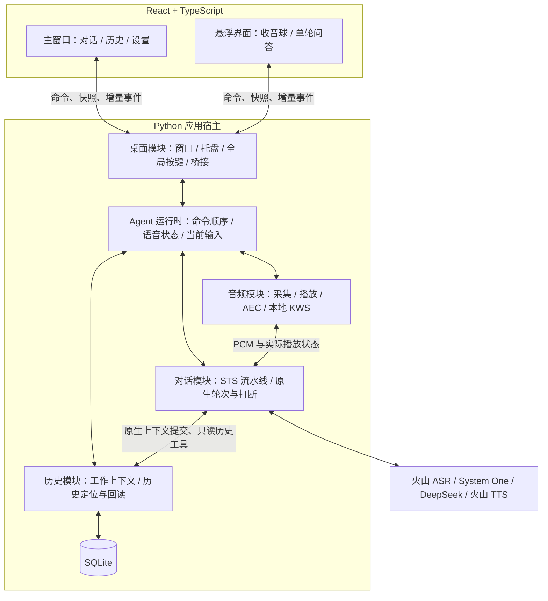
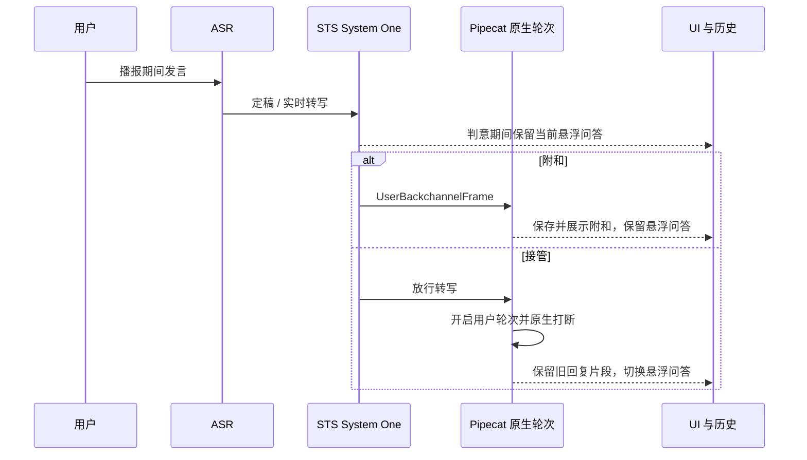

# V1.0.0 整体技术架构

日期：2026-11-07。

状态：技术方向已确认，阶段 01～04 的独立启动、桌面桥接、文字对话及保存恢复已完成，其余接入与实测按阶段推进。用户已选择单 Python 宿主分线程运行、沿用 STS 对应的 Pipecat Git 版本、SQLite 保存历史和引用回读，首版暂不生成滚动摘要。产品规则以 [V1.0.0 PRD](../prd/V1.0.0.md) 为准，外观和界面操作以 [UI 设计](V1.0.0-ui.md) 为准；下文标注的实现建议与验证任务继续按源码和实测推进。

执行顺序、任务依赖和验收分配见 [V1.0.0 实现计划](../plan/V1.0.0-implementation-plan.md)。

## 1 整体结构

采用一个 Python 应用宿主，主线程运行 pywebview，后台线程运行一个 asyncio 事件循环。后台持有唯一的 Agent 运行时；主窗口和悬浮窗使用同一套 React 前端，通过桌面桥接发送命令、接收状态与消息。

这里的单宿主指一个 Python 应用实例。WebView2 自身的浏览器子进程由渲染器管理。应用在 Windows 用户会话内手动启动并托盘常驻。



核心建议是将“应用持续存在”“当前对话执行对象”“当前语音连接”分开管理。窗口隐藏不销毁 Agent，返回待唤醒关闭云端识别连接，执行对象因错误取消后可以在已有上下文上重新创建。

### 1.1 进程方案比较

| 方案 | 收益 | 代价 | 建议 |
| --- | --- | --- | --- |
| 一个 Python 宿主，GUI 与 asyncio 分线程 | 生命周期集中；可以直接桥接；一个运行时维护上下文与状态 | 原生模块导致的进程崩溃会影响整个应用；阻塞工作必须离开事件循环 | V1 已选择 |
| GUI 宿主和 Python 后台分进程 | 可以独立重启后台，隔离部分进程故障 | 增加进程监督、通信连接、退出同步和状态恢复 | 有独立运行或崩溃隔离需求后再选择 |

前端与后台的职责分别管理。本版由桌面桥接承接业务通信；前端开发服务器和本地静态资源服务只负责页面加载。

## 2 模块职责与数据归属

以下是代码组织建议，各模块先提供少量直接操作。根据现有变化点设置适配位置，具体实现留在所属模块内部。

| 模块 | 持有的数据与资源 | 对外职责 |
| --- | --- | --- |
| 桌面模块 `desktop` | pywebview 窗口、托盘、全局按键监听、窗口可见性及悬浮手动隐藏标志 | 启动、显示、隐藏、明确退出；把界面操作交给运行时，把后台状态显示到窗口 |
| Agent 运行时 `runtime` | 语音状态、能力可用性、当前输入及回复关联、空闲计时、正在执行的控制动作 | 接收文字、唤醒、结束语音、恢复语音、重新开始、应用设置；安排异步工作与取消 |
| 对话模块 `conversation` | 当前 Pipecat worker、聚合器、System One、模型和语音协议适配对象 | 执行 STS 轮次与打断；报告输入、回复、工具与原生上下文提交；取消后释放执行资源 |
| 音频模块 `audio` | 默认设备、采集与播放流、播放参考、AEC、KWS、必要的短时内存音频 | 待唤醒检测；激活时提供 PCM；播放与停止；报告音量和设备变化 |
| 历史模块 `memory` | 持久化消息、当前工作窗口、模型消息、稳定引用和历史查询 | 保存、恢复、重开工作窗口、准备有限上下文、定位并回读原文 |
| 前端 `frontend` | 已收到的展示数据、输入草稿、阅读滚动位置及视觉状态 | 渲染主窗口和悬浮内容；提交用户操作；按后台事件更新展示 |

Agent 运行时和 Pipecat 都在后台事件循环内协作。Pipecat 聚合器负责原生消息的提交时点，历史模块负责保存和上下文装载。UI 从事件和快照展示消息，模型上下文从原生提交结果恢复。

建议同一时刻只有一套对话执行对象写入当前工作上下文。语音和文字属于输入来源，工具执行仍属于发起该回复的上下文。后续扩展电脑操作时，可以在现有模型工具注册位置接入，再根据具体能力增加执行模块。

## 3 线程、桥接与状态同步

### 3.1 已核对的约束

pywebview 的 GUI 循环要求在主线程启动；暴露给 JavaScript 的 Python 方法在独立线程执行。前端应等待 `pywebviewready` 后调用桥接。后台原生窗口操作需通过 GUI 的调度方式执行。[pywebview 使用说明](https://github.com/r0x0r/pywebview/blob/6.2.1/docs/guide/usage.md)、[桥接说明](https://github.com/r0x0r/pywebview/blob/6.2.1/docs/guide/interdomain.md)。

Python asyncio 提供跨线程投递回调和协程的入口。建议桥接线程使用 `call_soon_threadsafe` 或 `run_coroutine_threadsafe` 把命令交给后台循环，音频回调也只投递数据；模型请求、数据库操作和窗口调用各自遵守所属执行环境。[Python 3.12 并发说明](https://docs.python.org/3.12/library/asyncio-dev.html#concurrency-and-multithreading)。

### 3.2 建议的命令和事件

以下为业务操作名称草案，描述调用者需要的能力；具体 Python/TypeScript 定义在实现时确定。

| 方向 | 操作或事件 | 关键语义 |
| --- | --- | --- |
| UI → 后台 | 获取当前快照 | 返回状态、当前展示范围和已有消息，窗口重新显示或页面准备完成时使用 |
| UI → 后台 | 发送文字 / 重新发送 | 快速确认接收，生成过程通过后续事件返回；重发读取原消息内容，追加新用户消息 |
| 桌面 → 后台 | 唤醒 / 结束语音 / 恢复语音 | 由运行时统一处理，窗口和按键入口共用相同操作 |
| UI → 后台 | 重新开始 / 查询历史 / 保存设置 | 按 PRD 改变对应数据；查询历史只返回记录 |
| 后台 → UI | 消息开始 / 文本更新 / 消息完成 | 携带消息标识、来源、所属回复及展示文本；真实处理状态供后台使用 |
| 后台 → UI | 语音状态 / 处理状态 / 失败与恢复 | 驱动状态区域、按钮及悬浮显示 |
| 后台 → UI | 麦克风音量 / 播放音量 | 两路数值分别驱动外环与播报音波 |

命令的状态修改按后台接收顺序执行，模型生成和网络读取作为可取消的异步工作继续运行。命令处理不能等待整段回答结束，否则后续“结束语音”和新输入无法及时接管。

后台推送使用固定的 JavaScript 接收函数和 JSON 数据。EdgeChromium 的 `evaluate_js` 实现会等待脚本结果，推送应通过桌面模块的发送任务执行，避免阻塞音频及模型事件循环。[EdgeChromium 实现](https://github.com/r0x0r/pywebview/blob/6.2.1/webview/platforms/edgechromium.py#L123)。

建议窗口准备完成后先注册接收器，再在后台同一次调度中订阅并取得快照；随后应用快照之后的事件。事件序号用于页面快照和增量顺序，消息 ID 用于更新对应消息。隐藏窗口可以暂停高频音量绘制，重新显示时取得最新快照；后台继续处理和保存对话。

流式文字可按短批次推送，音量按 UI 更新频率采样；具体频率通过实际渲染和音频延迟测试确定。持久化消息不依赖前端是否已经收到推送。

### 3.3 阶段 02 已落实的桌面边界

- 单实例使用 Windows 当前会话的命名 Mutex 对象存续期判定；第二次启动通过命名 Event 通知原实例显示主窗口。通知线程在后台循环停止前结束。
- `DesktopApi.connect()` 在后台同一次调度内完成订阅和快照，返回窗口身份、状态及序号。`command(name)` 将操作投递到同一后台循环；窗口命令再由桌面模块调度到 GUI。
- 后台通过队列提交完整状态；独立 `desktop-events` 线程调用固定的 DOM `agent-state` 事件。连续完整快照可以合并，窗口控制命令保留顺序。后续消息增量需要按各自事件语义处理。
- 页面先注册事件接收器，再调用 `connect()`；桥接返回前的推送先暂存，以序号衔接快照。重载时重新订阅，窗口隐藏期间后台持续运行。
- Windows 窗口与托盘适配集中在 `desktop/host.py`。复用 WinForms 的 `NotifyIcon` 与 `BeginInvoke`；悬浮宿主使用原生 `Region` 裁出圆角卡片和圆球，外部与间隙由系统进行命中测试。
- 悬浮窗使用 `focus=False`，显示时直接调用原生 `Show()`；任务栏使用扩展窗口样式处理，保留 WebView2 初始化时的窗口句柄。区域计算采用 `GetDpiForWindow`，本机 200% 缩放下已验证。

窗口形状、焦点、托盘、连续推送及退出结果见 [阶段 02 验证记录](../verification/stage-02.md)。语音激活与悬浮显示规则在阶段 06、13 结合真实语音状态接入。

### 3.4 阶段 03 已落实的文字边界

- `DesktopApi.send_text(text)` 返回用户消息 ID 与回复 ID。运行时按接收顺序写入展示消息和输入队列，串行执行接管；模型网络请求在 Pipecat 中异步运行。
- `conversation.py` 使用一个 `LLMContext` 和 `LLMContextAggregatorPair`，文字流水线为用户聚合器 → DeepSeek → 助手聚合器。`ExternalUserTurnStrategies` 使文字装配无需语音轮次模型。
- 接管沿 RTVI 的 `broadcast_interruption()` → `flush_pipeline()` → `LLMMessagesAppendFrame(run_llm=True)` 顺序。等到助手处理完原生开始帧，再处理下一条文字，保证连续输入均已追加；此等待不包含模型返回首字的网络耗时。
- 流式展示读取助手聚合器的同步 `on_before_process_frame`；回复结束在同步 `on_after_process_frame` 中发布，此时原生聚合器已提交上下文。框架的 `on_assistant_turn_stopped` 默认异步调度，因此当前展示关联采用同步帧事件。
- 展示消息含 ID、来源、回复 ID、时间、文本、状态及错误；原生模型消息继续由上下文持有。运行时将消息字典复制进完整快照，桌面发送线程可合并连续快照，页面按序号恢复。
- DeepSeek 请求关闭 SDK 自动重试，客户端随流水线关闭。配置缺失保留 UI；普通请求错误绑定原回复；永久错误沿原生 CANCEL 结束执行对象并显示检查配置与重启提示。完整恢复在阶段 09 接入。

接入位置、测试及真实模型与桌面验收结果见 [阶段 03 验证记录](../verification/stage-03.md)。

## 4 STS 的复用方式

### 4.1 当前源码事实

已核对的语音顺序如下：

```text
音频输入 → 火山 ASR → System One → 用户聚合器
        → DeepSeek → 火山 TTS → 音频输出 → 助手聚合器
```

Silero VAD、转写判起和默认 Smart Turn 共同管理轮次。用户与助手聚合器共享 `LLMContext`。System One 只在助手播报时判断附和或接管；助手尚未播报时，转写直接进入原生用户轮次流程。[STS 入口](E:/CodeHub/Agent/sts/bot.py:53)、[System One](E:/CodeHub/Agent/sts/system_one_interruption.py:99)。

### 4.2 建议的装配方式

对话模块按能力装配两种执行配置，复用原生聚合器、DeepSeek 和工具取消机制：

- 语音配置：保留上述节点顺序，本地音频接入替换浏览器 transport；火山 ASR 增加按需连接，待唤醒期间不连接识别服务；文字请求通过已有输出选择跳过 TTS。
- 文字配置：使用同一工作上下文和原生聚合器、模型、历史工具，省去需要语音凭据及设备的处理节点。该配置用于启动时语音不可用，以及语音 worker 被取消后继续文字交流。

这两种配置属于本项目新增装配能力。后台持有上下文与历史，切换执行对象时先完成旧对象的取消、提交和资源结束，再绑定新对象。普通唤醒只开启 ASR 连接和音频路由；正常待唤醒转换不需要重新创建整个 Agent。

语音 worker 的永久错误仍沿 STS 的 CANCEL 语义处理。后台记录具体失败、完成清理，并在模型可用时建立文字执行条件；用户主动恢复后重新准备语音能力，成功回到待唤醒。恢复过程中正在进行的文字轮次应在受控切换点交接，具体顺序在验证 P-03 中确认，保证当前上下文只有一个写入者。

**新增适配位置**：火山 ASR 的 setup 当前直接连接云端，需将连接建立、关闭和 worker 生命周期分开；文字配置、音频接入、状态投影与恢复由本仓库实现。[ASR setup](E:/CodeHub/Agent/sts/local_volcengine_services.py:51)、[worker 不可用处理](E:/CodeHub/Agent/sts/src/pipecat/pipeline/worker.py:1652)。

### 4.3 源码与依赖来源

2026-11-07 本地核查结果：

| 项目 | 实际情况 | 建议 |
| --- | --- | --- |
| STS 底层仓库 | origin 为 `pipecat-ai/pipecat`；当前提交 `de8998789`，`git describe` 为 `v1.14.0-385-gde8998789` | 已选择按该源码版本接入，使用明确 Git revision 的依赖来源 |
| 已安装元数据 | 先前核查记录为 `1.15.0`，当前使用本地 editable 安装 | 将元数据与实际 Git 源码来源分别记录 |
| 根目录定制实现 | `bot.py`、火山适配、System One 和定制测试在 STS 中为未跟踪文件 | 所需内容迁入本仓库并独立维护，明确原始来源 |
| Python | STS 既有环境为 3.12 | 阶段 01 已验证 CPython 3.12.13，本项目使用 3.12 系列并由 uv 管理 |

先复现已研究的源码行为，再评估切换正式发布版的收益和迁移量。依赖版本来源属于常规 Git/uv 依赖管理；本项目运行时使用自己的环境和代码。迁入与调整发生在本仓库，参考 STS 继续用于阅读对照。

## 5 关键交互时序

### 5.1 启动、唤醒与回待唤醒

1. 桌面模块取得单实例运行权；重复启动请求转给已有实例显示主窗口。
2. 打开本地历史，恢复工作窗口和原生上下文；显示主窗口并报告配置、模型及语音能力状态。
3. 语音可用时打开默认采集设备运行本地 KWS，云端 ASR 保持未连接；文字输入可以独立执行。
4. 本地词命中或组合键持续按住 1 秒后，运行时进入准备状态，准备云端识别和播放资源。
5. 识别链路可接收指令后播放“叮”声，进入交互状态；用户随后发言，沿 STS 轮次处理。
6. 主动结束、按钮或有效空闲超时后，完成对应取消或收尾，关闭 ASR，恢复本地唤醒检测并保留上下文。

提示音也经过统一播放路径提供 AEC 参考，避免单独播放导致参考缺失。正常结束可带 Agent 决定的收尾话；按钮结束直接取消对应语音处理。

### 5.2 播报期间语义接管



图中 UI 展示通知为本项目新增事件订阅；分类、放行和原生打断顺序来自 STS。分类尚未完成时，完整转写保存在对应输入处理中；确认接管后再呈现于新的悬浮问答。

### 5.3 UI 文字接管未完成语音

已核实：RTVI 依次执行打断、flush、输出配置和追加文字；flush 只覆盖已进入流水线的处理。云端在途 ASR 和用户聚合器的未完成语音需要额外协调。[RTVI 文字处理](E:/CodeHub/Agent/sts/src/pipecat/processors/frameworks/rtvi/processor.py:475)、[用户消息追加](E:/CodeHub/Agent/sts/src/pipecat/processors/aggregators/llm_response_universal.py:1392)。

建议的协调步骤：

1. 收到文字时结束旧语音输入的接收范围，暂停旧输入继续进入用户聚合器；已提交的历史保留。
2. 按 RTVI 顺序打断回复并等待其提交。取消旧 System One 候选、未完成的轮次判断与语音聚合，避免旧轮次随后再次触发模型。
3. 将文字作为新输入追加，回复选择文字输出。
4. 新语音继续接入。接管时已经说到一半的语音及其迟到识别归属于旧输入；后续新发言进入新的输入范围。

这里需要识别结果和音频输入的真实关联，不能以“收到转写的时间晚于文字发送”判定其属于新发言。建议在 ASR 连接和采集序列上保留所属输入标识；连接更换后的旧接收任务仅能产生旧输入结果。

**待验证的具体实现**：优先验证重建受影响语音输入对象、保留已提交上下文的方案；若需要替换整个 worker，必须先完成原生打断提交，再创建新 worker。比较这种方式与本项目内局部聚合器适配的改动量及接管延迟后，选择一种实现。`UserTurnResponseCancelFrame` 取消的是推测回复，控制器可能再次发起推理，不应把它当作清除旧语音轮次的现成入口。[原生帧含义](E:/CodeHub/Agent/sts/src/pipecat/frames/frames.py:1462)、[控制器处理](E:/CodeHub/Agent/sts/src/pipecat/turns/user_turn_controller.py:560)。

上述实现选择是 P-03 的源码与行为验证任务。接管期间若要暂存新发言音频，只使用内存，恢复后只送入属于新发言的部分；缓冲范围和等待行为随该验证确定。

### 5.4 历史读取、主动结束与空闲

历史工具继续使用原生 `cancel_on_interruption`：新输入接管时取消未完成调用，已完成结果保留，迟到结果不能恢复旧回复。UI 的“正在读取历史”来自实际工具开始和结束事件。[工具注册](E:/CodeHub/Agent/sts/src/pipecat/services/llm_service.py:1228)。

建议用一个受限的内部 `end_voice` 动作让 Agent 表达结束意图。若有收尾应答，运行时把待结束动作关联到该回复，待实际播报结束后回待唤醒；新输入打断该回复时，同时取消旧回复尚未执行的结束动作。该内部动作与只读历史工具分开注册，其职责限于语音状态转换。

空闲计时由实际活动集合决定：语音交互中且没有收音、识别、分类、生成、工具或播放工作时，进入等待计时。使用单调时钟管理本次等待期限；状态变化暂停计时，再次进入等待从设置时长开始。异常进入不可用状态并展示原因，原生 worker 的默认空闲取消不承担产品超时职责。

## 6 音频与 Windows 桌面

### 6.1 音频路径

建议由音频模块独占采集和播放资源，KWS 与云端识别按状态共用采集路径。ASR 输入沿用 STS 的 16 kHz 单声道 PCM，TTS 返回沿用 24 kHz；设备采样率、重采样和 AEC 块格式在设备验证中确定。

```text
默认麦克风 → 采集与重采样 → 回声处理 → 本地 KWS（待唤醒）
                                      → STS 输入（语音交互）

TTS / 提示音 → 可取消播放队列 → 默认播放设备
                           └→ 对齐后的实际播放参考 → 回声处理
```

回声参考来自实际交付播放的音频，取消后未播放的音频也从对应参考中移除。停止播报包含应用队列与设备缓冲两部分，实际停止耗时需要测量。麦克风与播放音量分别输出，前端按已确认的动效规则使用。

候选继续采用 `sherpa-onnx` 本地 KWS 和 `pywebrtc-audio` AEC；它们仍是验证候选。KWS 的自定义词条需要转换到模型 token，必须实测“你好小博”和改词效果。[KWS 官方说明](https://k2-fsa.github.io/sherpa/onnx/kws/index.html)。AEC 候选与已有分发文件核查见 [音频方案研究](../research/sts-integration-options.md)。

LocalAudio 当前在 setup 打开流，start 启动已有流，缺少默认设备变化处理。因此本地音频适配需要根据 PRD 的待唤醒、交互中和设备失效三种情况决定何时重建资源。重新打开设备时一并处理 KWS、采样格式、AEC 与播放参考。[本地音频实现](E:/CodeHub/Agent/sts/src/pipecat/transports/local/audio.py:34)。

### 6.2 圆形悬浮窗的可行性

建议先使用主窗口和一个承载整个悬浮组件的窗口，后者在页面内布局圆球、上方问答框和悬停按钮。这样显示、隐藏及手动隐藏状态集中在同一窗口。

需要先验证的事实差异：pywebview 6.2.1 的 API 文档写明 Windows 不支持 `transparent`，但同版本 WinForms 与 EdgeChromium 源码包含透明背景处理。WinForms 的 show 路径调用 `Activate()`，而 `focus=False` 又设置不激活样式。源码支持说明具备相关实现，无法直接证明本项目所需的透明背景和焦点效果。[API 文档](https://github.com/r0x0r/pywebview/blob/6.2.1/docs/api/README.md)、[WinForms 实现](https://github.com/r0x0r/pywebview/blob/6.2.1/webview/platforms/winforms.py#L261)、[显示实现](https://github.com/r0x0r/pywebview/blob/6.2.1/webview/platforms/winforms.py#L451)。

建议允许桌面模块内少量 Windows 原生适配，通过宿主句柄控制可见区域和不抢焦点的显示；例如 `SetWindowRgn` 可限定系统绘制区域。具体采用透明合成还是形状区域，应以 P-01 的渲染结果确定。[Microsoft 窗口区域说明](https://learn.microsoft.com/en-us/windows/win32/api/winuser/nf-winuser-setwindowrgn)。

验证必须覆盖圆球外空白区域、问答框间距、阴影、悬停按钮可点击区域、内部滚动及 Windows 缩放。圆球单独出现和问答框展开都需验证。产品外观继续按已选效果图执行，技术失败时记录具体限制后讨论调整。

## 7 历史、工作上下文与恢复

### 7.1 SQLite 保存

完整历史和当前工作窗口保存在一个本地 SQLite 数据库中，由历史模块统一访问。SQLite 提供事务，可把相关消息提交和窗口状态更新一起保存。[SQLite 事务说明](https://www.sqlite.org/transactional.html)。

以下为完整版本的逻辑数据规划。阶段 04 已落实展示消息、原生模型消息与当前工作范围；初始脚本采用用户确认的 `V1.0.0_001`，后续结构变更继续新建经确认版本的脚本。

| 数据 | 建议保存的内容 | 使用方式 |
| --- | --- | --- |
| 展示消息 | 稳定 ID、时间、输入来源、回复关联、展示文本、真实状态、附和属性 | 主界面、悬浮投影与历史原文 |
| 模型消息 | 原生 role/content、工具调用与结果、对应展示消息的关联 | 恢复 STS 实际提交的上下文 |
| 当前工作窗口 | 当前展示起点、纳入模型窗口的消息、有限预览与历史引用 | 跨重启恢复；重新开始时替换 |
| 交互设置 | 当前有效设置，以及已经保存但待进入待唤醒时应用的唤醒词 | 启动恢复与设置生效反馈 |

展示文本、模型提交文本和用户实际听到的声音各有含义。原生火山 TTS 没有词级播放位置，不能把 UI 的完整回复文字全部当作用户已听完的内容。持久化以原生提交事件和 UI 展示事实分别记录。[STS 文本提交依据](../research/sts-voice-reference.md)。

流式展示片段可以合并写入，用户消息提交、助手完成/打断、工具结果、重新开始及正常退出是明确保存时点。数据库写入放在串行 I/O 执行位置，避免长历史查询阻塞音频循环；历史查询本身分页执行。保存失败须报告，不能对尚未保存的内容宣称恢复成功。

阶段 04 的数据库为 `.local/data/agent.sqlite3`，使用 Python 标准库 `sqlite3`。`memory/store.py` 的单线程执行器负责连接的创建、读写和关闭，连接继续使用 SQLite 的线程归属约束。

| 实际表 | 保存内容 | 顺序与关联 |
| --- | --- | --- |
| `display_messages` | 稳定 ID、role、来源、reply_id、展示文字、真实状态、UTC 时间及错误原因 | 独立 position 表达展示顺序；同次接收的用户消息和助手占位一起保存 |
| `model_messages` | 原生消息的完整 JSON、对应展示消息 ID | 独立 position 保留模型实际提交顺序；展示关联使用外键 |
| `working_window` | 当前展示起点和模型上下文起点 | 启动按保存范围恢复；当前普通对话从完整范围开始 |

脚本为 `memory/migrations/V1.0.0_001__init_conversation.sql`，SQLite `user_version=1` 对应该版本。首次打开时初始化表和工作范围，脚本也随 Python 包构建产物分发。交互设置在阶段 14 接入。

保存与恢复按以下时机执行：

1. 用户文字接收后保存展示消息对；进入原生流水线后的上下文由实际帧处理事件采集。
2. 助手开始帧确认已提交的用户输入；结束、打断或取消帧完成后采集原生上下文。展示文字和原生内容分别记录在同一保存事务中。
3. 流式展示文字按约 250 毫秒合并写入；用户提交、原生提交和退出可提前触发保存。写入期间出现新内容时，状态继续显示保存中，直到最新内容完成事务。
4. 明确退出时暂停新输入，取消输入任务与原生执行对象，采集最终上下文，将剩余排队或生成中的回复标为 `unfinished`，再等待最终事务。输入已进入上下文但助手尚未开始的情况，也通过关闭后的最终采集保存。
5. 保存成功后关闭窗口和资源。保存失败时暂停新消息、显示原因并保留主窗口；用户处理原因后再次退出，重新尝试保存。
6. 启动加载两类消息和工作范围。未完成记录保留文字及状态，由用户继续输入；模型执行对象在收到新输入时使用保存的原生消息装配。

重新开始、有限预算和历史回读继续在阶段 10～11 接入。第四阶段验证结果见 [保存与重启恢复记录](../verification/stage-04.md)。

### 7.2 有限窗口与历史回读

首版采用：系统指令 + 当前问题 + 预算内近期完整轮次 + 更早内容的有限预览与稳定引用。历史原文持续保存在数据库，模型通过只读工具查找并展开。预览从原文截取并附时间和引用；首版暂不调用模型生成滚动摘要。预算包含输出余量与工具结果余量，具体数值依据采用的模型配置核对。

建议提供两个工具职责：

| 工具草案 | 输入 | 返回 |
| --- | --- | --- |
| `history_search` | 关键词/主题线索、可选时间范围、页大小与续页位置 | 有限结果、消息 ID、时间、预览及原文读取入口 |
| `history_read` | 消息或关联轮次引用、正文偏移与读取长度 | 原文片段、来源与状态、关联消息引用、续读位置 |

模型可将主题拆为关键词、改写关键词并按时间缩小范围；检索为空时依据实际结果继续定位或追问。按引用读取的是原文，预览只是定位依据。附和及未完成回复在返回时带真实属性，帮助模型判断其含义。

这种方式借鉴 Super-agent 的有限内容与资源回读入口。官方原型确实提供带 resource、offset、limit 的读取工具；本项目的消息结构、工具名字和搜索方案是自身设计。[Super-agent 工具源码](https://github.com/deepseek-ai/dsh-superagent-prototype/blob/main/src/app/tools/tool.ts)、[架构文档](https://github.com/deepseek-ai/dsh-superagent-prototype/blob/main/docs/007-architecture.md)。

中文定位建议先实现关键词子串与时间过滤，并测量历史增长后的查询耗时；需要全文索引时评估 FTS5。FTS5 trigram 的全文查询对少于三个 Unicode 字符的片段不返回匹配，因此两字中文词需明确使用普通子串查询，不能直接把 trigram MATCH 作为所有中文关键词的实现。[SQLite FTS5](https://www.sqlite.org/fts5.html#the_trigram_tokenizer)。

窗口裁剪以完整轮次和工具调用/结果关联为单位，保留续读引用；未完成工具调用在取消结果提交后再整理。普通完成、打断及工具循环请求都要使用一致的预算入口，具体接入点列入 P-04。

### 7.3 滚动摘要的选择记录

| 选择 | 收益 | 代价 | 建议 |
| --- | --- | --- | --- |
| 近期完整内容 + 文本预览/引用 + 按需回读 | 直接保存和读取原文，减少额外模型请求；更接近当前可核实的原型机制 | 模型可能需要更多回读；预览对复杂旧主题的概括较弱 | 首版已选择 |
| 在上述机制上增加模型生成的滚动摘要 | 更早内容能以语义概要继续留在窗口 | 增加摘要生成、取消与更新流程；需要评估遗漏和误概括 | 有明确收益后选择 |

用户已选择首版暂不生成滚动摘要。完整历史持续保存，长期细节通过原文回读取得。后续如果增加摘要，仍应保留对应原文引用。

### 7.4 重新开始与重启

“重新开始”先打断并提交旧回复，事务中更新当前展示起点和工作上下文；旧消息和引用继续存在。新窗口仅以系统指令和后续输入工作，需要历史时主动查询。

重启加载当前窗口及原生模型消息，保留历史中的未完成状态，进入待唤醒或明确不可用状态。此前任务不会自动续写或重播；工具调用必须恢复为可解释的完整记录，不能把孤立调用当作仍在执行的任务。

## 8 建议目录

```text
voice-super-agent-wxy/
  pyproject.toml                 Python 与 uv 依赖声明
  src/voice_super_agent/
    app.py                      应用装配和启动退出
    desktop/                    窗口、托盘、按键与桥接
    runtime.py                  Agent 命令和状态协调
    conversation/               STS 装配、定制语音代码与事件接入
    audio/                      设备、AEC、KWS、采集播放
    memory/                     保存、上下文装载、历史工具
  frontend/                     React + TypeScript + Vite
  tests/                        核心流程与必要集成验证
  docs/
```

该目录用于讨论模块归属，实际文件按实现内容建立。跨模块对象尽量使用业务输入、状态和消息；Pipecat 帧、WinForms 句柄、数据库连接分别留在所属模块内部。

## 9 先验证的四条关键路径

| 编号 | 验证内容 | 产出与通过条件 | 关联 PRD |
| --- | --- | --- | --- |
| P-01 | 桌面窗口与桥接 | 主窗口、圆形悬浮窗、非激活显示、滚动/悬停和隐藏常驻可用；确认渲染器与必要原生适配；后台事件不阻塞界面 | T-01、AC-01、21、22、31、35 |
| P-02 | 音频与本地唤醒 | KWS 命中后连接 ASR，提示后可说；外放时附和与接管保持 STS 语义；覆盖默认设备变化和恢复 | T-06、AC-02、19、32、36 |
| P-03 | 输入接管与故障后文字可用 | 未完成语音被文字替代，旧转写迟到无旧回复，新语音正常；永久语音错误后文字仍能接续；确认对象重建方式 | T-05、T-10、AC-33、34、37、38 |
| P-04 | 有限上下文与历史恢复 | 历史原文回读、中文短词与时间线索、工具取消、窗口裁剪、重新开始和重启接续 | T-07、T-08、T-09、AC-13、14、15、24、25、39 |

每项先验证核心行为，再扩展相应完整功能。依赖独立安装和定制代码迁入随这些路径落实；测得的延迟、资源及声学效果写回 PRD 的 T-12。当前文档依据源码与官方资料，尚未运行这些验证。

## 10 本轮确认结果与剩余工作

1. **运行与通信已确认**：一个 Python 宿主，GUI 与后台分线程，使用 pywebview 桥接。
2. **Pipecat 来源已确认**：先沿用 STS 对应的 Git 源码版本接入，使用本仓库自己的代码与 uv 环境。
3. **历史与工作窗口已确认**：SQLite 保存历史，采用近期完整内容、有限预览/引用及模型按需回读；首版暂不生成滚动摘要。

阶段 01 已完成独立依赖安装、EdgeChromium 基础窗口、前端构建与后台线程启动/关闭，结果见 [验证记录](../verification/stage-01.md)。剩余工作为第 9 节的四条关键路径：悬浮窗口与音频适配、输入接管和恢复的对象重建顺序，以及历史工具、数据字段和上下文预算；这些项目的可行性继续由源码与运行结果确定。
