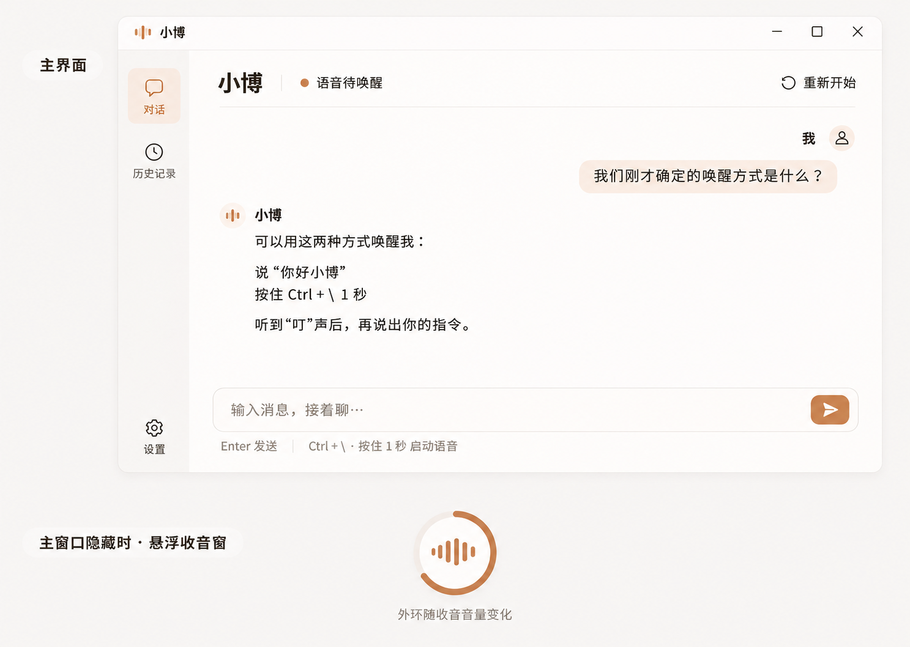
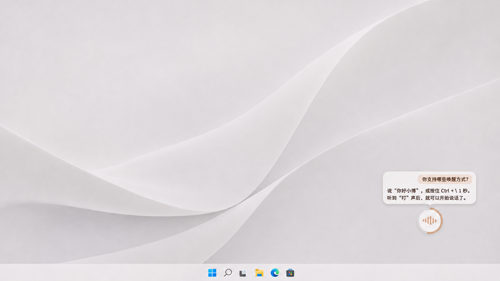

# V1.0.0 UI 设计

更新日期：2026-11-07。

主界面与悬浮收音窗的外观，以及本轮需求收敛中的交互规则已经用户确认。本文记录选定效果及交互规则，产品流程与 STS 迁移依据见 [V1.0.0 PRD](../prd/V1.0.0.md)。

## 1 选定效果图

### 1.1 主界面

以图中上半部分的主窗口为主界面参考：暖白底、浅杏色气泡、琥珀色点缀。主窗口显示时，由主窗口承载交互信息。悬浮组件的最终外观与桌面比例见下一张图。

### 1.2 悬浮收音窗

以用户确认的缩小版为参考：主窗口隐藏或最小化且满足第 4 节显示条件时，右下方显示紧凑收音球，单轮对话框位于其上方，两者之间保留小段间距，并避开任务栏。

这两张图由 Image Gen 生成，分别对应主界面暖白配色确认稿和 2026-11-07 悬浮组件缩小确认稿，用于对照外观与相对比例。它们是静态设计效果图；像素尺寸、字号、圆角和间距在实际界面及 Windows 缩放下落实。此前讨论中的尺寸建议作为探索过程，不作为已确认的数值。

悬停按钮、准备与识别提示、错误恢复等状态按下文交互说明实现，静态效果图未完整展示这些状态。

## 2 视觉与布局

| 区域 | 已确认设计 |
| --- | --- |
| 整体配色 | 暖白为主，浅杏色用于用户气泡与选中区域，琥珀色用于按钮、音波和音量环；文字使用清晰的深暖灰 |
| 主界面导航 | 左侧对话与历史记录入口，设置在侧栏底部 |
| 主界面顶部 | Agent 名称与当前状态；语音准备或交互期间在状态旁提供“结束语音”，右侧提供“重新开始”入口 |
| 主界面用户消息 | 头像与“我”在右侧独占一行，气泡在其下方靠右 |
| 主界面助手消息 | 图标与“小博”在左侧独占一行，回复在其下方 |
| 主界面输入 | 底部文字输入与发送操作，展示 Enter 发送及 `Ctrl + \` 按住 1 秒唤醒的提示 |
| 失败文字消息 | 在原用户消息气泡旁提供“重新发送”，按第 5.2 节处理 |
| 收音球 | 右下方紧凑圆形；中央为音波动画，外环以亮起弧长表示麦克风收音强弱，声音越大弧线越满 |
| 悬浮对话框 | 位于收音球上方的圆角矩形，展示当前一轮问答，采用缩小后的紧凑比例 |
| 悬浮框内用户发言 | 靠右的浅杏色气泡 |
| 悬浮框内助手回复 | 暖白底上的靠左文字 |
| 悬浮框身份区分 | 通过背景色和位置区分双方，省去头像、姓名标签 |

完整对话和历史入口由主界面承载。用户围绕统一的 Agent 交流，界面沿用 PRD 的连续上下文规则。

### 2.1 收音球动效

| 状态 | 中央音波表现 |
| --- | --- |
| 正在准备或正在识别 | 音柱小幅、缓慢循环，圆球下方短暂显示“正在准备”或“正在识别”；阶段结束后收起文字 |
| 聆听用户 | 随用户声音起伏，安静时收为短音柱 |
| 正在思考或读取历史 | 音柱小幅、缓慢地循环起伏 |
| 助手正在播报 | 随实际播放的声音起伏 |

外环始终以麦克风收音大小驱动亮起的弧长。助手播报时，中央音波反映播放声音，外环继续反映麦克风输入。语音就绪时播放清脆“叮”声；主窗口顶部同步展示准备、识别等实际状态。失败原因及恢复入口见第 5.3 节。

## 3 单轮悬浮展示

以下交互在悬浮组件符合显示条件时生效；手动隐藏规则见第 4 节。

| 事件 | 展示行为 |
| --- | --- |
| 用户开始本轮提问 | 圆球上方自动出现对话框，显示识别文字 |
| 助手生成回复 | 在同一框内逐步展示回复，形成一问一答 |
| 本轮完成 | 保留本轮内容，方便查看 |
| 新问题进入用户轮次 | 替换上一轮内容，显示新的问题和回复 |
| 播报期间尚在识别或判断新发言意图 | 保留当前问答，等待确认接管后切换 |
| 播报期间被 STS 判为附和 | 保留当前问答，助手继续回复 |
| 播报期间被 STS 判为接管 | 沿原生打断流程停止旧回复，切换到新一轮并显示已识别的新发言 |

一轮的边界依照 PRD 第 5 节的 STS 轮次机制：ASR 分句定稿与轮次结束分别处理。播报期间使用 System One 的语义判断，其他阶段沿原生转写判起与打断流程处理。

悬浮框替换内容只改变当前展示范围。主界面与完整历史继续保留旧问答、附和及真实消息状态，Agent 上下文继续接续。主界面中的被打断回复仍以普通文字展示。

长回复达到对话框最大高度后，在框内滚动。默认跟随最新生成的内容；用户主动向上滚动阅读时暂停跟随，保留当前阅读位置；用户回到底部后恢复跟随。最大高度的具体数值在实际渲染时落实。

## 4 显示与隐藏

应用启动后显示主窗口，语音可用时进入待唤醒。重复启动唤出已有主窗口，应用保持单实例与同一份 Agent 上下文。关闭主窗口后继续托盘常驻，明确退出才结束应用。

| 条件或操作 | 行为 |
| --- | --- |
| 主窗口显示 | 由主窗口展示交互信息，悬浮组件收起 |
| 主窗口隐藏或最小化，处于唤醒准备或语音交互，且本次激活未手动隐藏 | 按状态自动显示悬浮组件，在普通桌面置顶，保留当前应用的键盘焦点 |
| 点击收音球悬停时出现的“×” | 同时隐藏圆球与对话框，语音接收、回复和空闲规则继续运行 |
| 点击主窗口或收音球的“结束语音” | 停止当前回复、播报及相应语音准备，回到待唤醒，保留上下文 |
| 本次激活中已手动隐藏，发生新发言或新回复 | 保持隐藏 |
| 主窗口隐藏或最小化且语音激活，从托盘选择“显示收音窗” | 手动找回 |
| 回到待唤醒 | 收起悬浮组件 |
| 下一次唤醒 | 按主窗口可见性等规则重新处理显示 |
| 悬浮组件可见时语音失败 | 保留当前问答，展示错误和恢复入口，按第 5.3 节处理 |

鼠标移到收音球上时，在圆球左上侧显示结束按钮，悬停提示“结束语音”；右上侧显示隐藏用的小“×”。指针位于圆球或任一按钮区域时保持按钮可见，移出后收起。结束入口在语音准备或交互期间可用；“×”按上述规则隐藏悬浮组件。

## 5 历史、设置与错误恢复

### 5.1 历史与设置

历史记录页按时间浏览、按需加载并可查看完整原文。浏览历史保持当前工作上下文，返回对话页后继续当前交流。“重新开始”停止当前回复，清空当前聊天展示并重新建立工作窗口，旧历史继续保存，供用户查看与 Agent 回读。

日常设置提供唤醒词、组合键及空闲超时。超时默认 60 秒，接受大于 0 的整数秒，保持自动超时启用；“结束语音”负责用户主动结束本次语音交互。保存无效或无法应用的设置时说明具体原因，保留该项原来有效的配置。组合键保存后生效，超时保存后使用新值且当前等待重新计时，唤醒词在下一次进入待唤醒时应用。模型凭据和服务参数使用本地 `.env`，修改后重启生效。

V1.0.0 跟随 Windows 默认录音和播放设备。待唤醒时采用新的默认设备；语音交互中旧设备可用时继续本次交互，下次唤醒采用新设备；当前设备失效时提示原因，由用户恢复语音。具体生命周期见 PRD 第 6.8 节。

### 5.2 输入与重新发送

语音输入得到语音和文字回复，UI 文字输入得到文字回复，共用上下文。普通文字输入保持当时的语音激活状态；发送文字会接管尚未完成的语音，旧转写迟到时不再触发回答，之后的新发言继续正常处理。

语音回答失败后，由用户再次发问。UI 文字回答失败后，在原用户消息气泡旁提供“重新发送”；点击在聊天底部追加一条相同内容的用户消息，按新的文字输入处理，原消息与已有回复片段保留，新回复以文字展示。TTS 失败时保留已有文字并提示原因，用户恢复语音后继续交流，独立重播入口留待后续版本。

### 5.3 能力不可用与恢复

语音配置或设备不可用时，主窗口、历史和设置继续可用，并说明原因。模型具备运行条件时文字对话继续可用；模型配置也缺失时，用户仍可查看历史和设置。

| 失败时的可见界面 | 反馈与操作 |
| --- | --- |
| 主窗口可见 | 在状态区域显示失败原因和“恢复语音” |
| 悬浮组件可见 | 保留当前问答，在对话框内增加简短错误说明和“恢复语音” |
| 悬浮组件已被用户手动隐藏 | 保持隐藏，通过托盘状态提示异常，用户打开主窗口后恢复 |
| 用户恢复成功 | 回到待唤醒，悬浮组件收起；保留历史和上下文，由用户再次唤醒 |

应用继续常驻，不自动重复整轮请求。此前未完成的回复由用户继续提问或按第 5.2 节重新发送。

## 6 后续实现与验证

| 项目 | 已确定边界与剩余工作 |
| --- | --- |
| 长回复尺寸 | 最大高度后内部滚动、默认跟随最新内容、手动上滚暂停及回到底部恢复的规则已确认；最大高度的具体数值在实际界面中落实 |
| 状态与动画 | 准备、识别、聆听、思考/回读、播报及失败反馈已确定；接入真实状态与音量数据，落实动画节奏和幅度 |
| 接管期间的展示 | 判意时保留当前问答、附和保留、确认接管后切换已确定；接入 STS 事件及新增文字接管边界 |
| 实际渲染与窗口 | 落实尺寸、字号、圆角、间距与 Windows DPI 适配，核对可读性、单实例、最小化、置顶、焦点及悬停按钮区域 |
| 其他页面与操作 | 历史浏览、设置校验、重新发送和错误恢复规则已确定；落实具体排版与运行状态联动 |

## 7 实现对照

实现时按 PRD 的验收场景核对：

- AC-01、AC-21 至 AC-23：启动、单实例、最小化、显示、隐藏与再次唤醒。
- AC-18、AC-24、AC-39：设置校验与生效、重新开始及历史浏览。
- AC-29 至 AC-32：单轮替换、判意期间的展示、长回复滚动及音波与音量环。
- AC-33 至 AC-35：文字接管、重新发送与结束语音。
- AC-36 至 AC-38：默认设备变化、能力不可用及不同可见界面的恢复流程。

语音轮次与打断沿用 STS 依据，UI 消费相应状态与消息事件。

当前材料完成视觉与交互记录，实际窗口、动效和音频行为仍需在开发阶段实现与验证。
