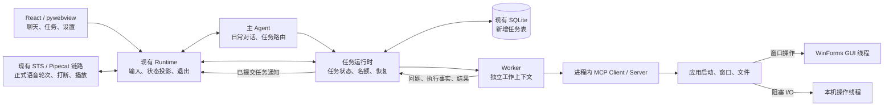

# Voice Super Agent V1.0.1 技术架构设计

日期：2026-11-20。产品规则以 [V1.0.1 PRD](../prd/V1.0.1.md) 为准，开发拆分见[双人并行施工方案](../plan/V1.0.1-implementation-plan.md)。

V1.0.1 保留 Windows 单实例桌面应用和一个面向用户的主对话。主 Agent 处理交流、判断任务归属和派工。任务运行时保存状态、执行调度和恢复。Worker 在独立上下文中处理具体任务，通过内置 MCP 工具操作本机。语音的接收、语义接管和播放沿用现有 STS 链路。

## 1 参考实现与本项目的取舍

| DeepSeek 原型 | V1.0.1 对应设计 |
| --- | --- |
| Source、Trigger、Thread | 语音与文字是本版输入来源。正式消息是可追踪的输入事件。通过消息与任务关联组织补充、答复和历史回读 |
| Eval、Mandate | 主 Agent 判断普通交流、任务派工、补充或控制。任务保存用户明确的目标、操作类型、对象及路径，运行时据此约束调用 |
| Ticket、Assignment、Executor | Task 持有目标和业务状态。Execution 记录一次实际执行。Worker 在执行记录下工作，暂停后继续、重试或异常恢复可以产生新执行记录 |
| Stored work、Outbox | 任务、待处理输入和通知先落库，再供执行、投递及展示。应用重启时核对已发起的实际动作 |
| Inline / Spill 与资源读取 | Worker 装载有限的本任务上下文，完整原文按引用读取。主 Agent 只接收控制所需的状态、问题和结果摘要 |

DeepSeek 原型区分任务与一次执行，并在恢复前核对外部事实。本项目借用这些职责，受 PRD 的桌面场景约束。主 Agent 直接处理日常对话。已完成或已取消的任务收到明确的新操作时创建关联任务。失败后的主动重试遵循 D-20、D-28，后台执行和 MCP 使用范围遵循 D-21～D-23。[DeepSeek 领域模型](https://github.com/deepseek-ai/dsh-superagent-prototype/blob/main/docs/001-domain.md) · [执行与恢复](https://github.com/deepseek-ai/dsh-superagent-prototype/blob/main/docs/003-execution.md) · [架构和资源读取](https://github.com/deepseek-ai/dsh-superagent-prototype/blob/main/docs/007-architecture.md)

STS 的参考入口为工作区相邻项目的 `E:/CodeHub/Agent/sts/bot.py`，双方使用同一类火山 STT/TTS、System One、用户和助手聚合器及原生接管。实际落地以本仓库已经迁入的实现为基准。V1.0.1 继续通过本仓库的 uv 环境独立运行。 [V1.0.0 语音流程](../prd/V1.0.0.md#5-sts-语音流程依据与迁移指示) · [依赖与迁入来源](../code-sources.md)

## 2 运行结构与模块归属



仍是一个 Python 宿主。GUI 线程持有 WinForms 和 WebView2，运行时 asyncio 线程持有主 Agent、任务运行时和 MCP 连接。阻塞的本机查询和文件动作离开事件循环执行。SQLite 继续由现有串行 I/O 线程持有连接。主 Agent 和 Worker 的模型调用独立异步推进，读取同一套已配置的 DeepSeek 参数，各自持有请求上下文及取消对象。

| 模块与建议位置 | 对外责任与所有权 |
| --- | --- |
| `runtime.py`、`conversation.py` | 输入提交、短任务命令、消息及通知的投影、实际交互忙碌状态、宿主退出。沿用原语音、文本、历史、接管、设置和单实例行为 |
| 新增 `tasks/` | 持有任务、执行记录、用户问题、任务范围和调度状态。负责串行处理状态修改、按容量派发、结果保存和恢复 |
| `tasks/worker.py` | 每次执行使用独立工作上下文。按任务输入准备模型调用，使用内置工具，提交进展、问题和结果事实 |
| `tasks/mcp_client.py` 与新增 `tooling/` | 前者管理进程内 MCP 会话和工具请求。后者提供内置工具的注册、参数校验、平台动作、真实状态核对及占用对象 |
| `memory/store.py` 与新增任务存储实现 | 延用原连接及事务执行线程。同一任务事务可以写入步骤、结果、任务状态和通知 |
| `desktop/host.py`、`frontend/src/` | 通过现有桥接与 Runtime 交互。GUI 线程实际执行窗口动作。任务卡片、列表和详情使用同一任务状态投影 |

代码入口见 [Runtime](../../src/voice_super_agent/runtime.py)、[Conversation](../../src/voice_super_agent/conversation.py)、[VoicePipeline](../../src/voice_super_agent/voice/pipeline.py)、[ConversationStore](../../src/voice_super_agent/memory/store.py) 和 [DesktopApi / Host](../../src/voice_super_agent/desktop/host.py)。

## 3 主 Agent 与 Worker

### 3.1 输入、派工和跟进

1. UI 文本入队后得到已有的用户消息 ID。语音沿 STS 的聚合结果，只有已提交、非推测的 `voice_committed` 提供任务意图输入。实时转写、附和和被文字接管的语音片段按旧流程显示和保存。
2. 主 Agent 保持原有流式答复，通过 Pipecat `FunctionSchema` 注册短命令。模型提出任务计划、查找、补充、问题答复或控制请求。运行时注入来源消息 ID 和输入方式，不以模型生成的 ID 或自述授权为准。
3. 派工前检查当前回复仍有权提交该输入的决定，确保原消息已持久化。一次决定产生的任务、来源关联和派工输入在同一事务中写入。提交后由任务运行时接管执行。即使原模型轮次已经取消或未收到工具返回，之后仍可从原消息取得这批任务的引用及状态。
4. 同一目标的依赖步骤归到一个任务。可独立交付的目标可拆为多项，用户看到各项任务。目标、路径、问题归属或任务归属含糊时，向用户澄清。
5. 执行中补充先保存，下一步前取用。持有操作权的当前步骤按已确认的边界结束。若最后一步已产出原结果而无下一步，保留补充与关联，告知原结果。明确的新操作创建关联任务。对已结束任务查询时直接读取历史结果。
6. 请求重发沿用关联原消息 ID。若任务批次已保存，返回现有任务列表及状态。已核实尚未建任务时才重新处理，状态不明时先查存储结果。普通聊天沿用原重发。已完成的提交经原始消息去重，聊天播放中断、回复失败或页面重载均不触发重复派工。

### 3.2 Worker 循环

Worker 动态选择任务范围内的工具并分步推进。每个任务同一时刻只持有一个有效 Execution，执行内按步骤顺序调用工具。准备每一步时读取已提交的任务输入、待处理补充、经核实的动作结果及必要原文。模型负责决定下一步方式，任务运行时负责状态改变、授权、资源占用和实际派发。

每轮 Worker 产出一种明确结果：工具动作、待用户问题、完成结果或失败。工具执行通过 MCP，业务成功依据工具状态与已保存的事实。Worker 形成的问题由任务运行时分配问题 ID，持久化后交由 UI 或语音反馈。任务详情回复带确切任务和问题 ID，聊天或语音则由主 Agent 解析，歧义时澄清。有效答复落库后重新排队，获得名额才继续。主动暂停意图仍有效时保留消息，等待用户请求继续。

Worker 可通过应用内只读查询获得本任务、来源对话和主 Agent 明确提供的相关引用。采用现有 `WorkingContext` 的有限窗口原则，保留同一轮或工具调用组的结构。新 Worker 以任务目标、待处理输入、执行结果及引用重建上下文，过大的模型输入和工具正文按结构缩减或分页。主 Agent 只取任务状态、问题和用户可用结果，完整执行记录由任务详情和回读接口提供。[现有工作窗口](../../src/voice_super_agent/memory/context.py)

实施时复用现有 DeepSeek 配置和异步模型客户端的初始化规则，Worker 独立发出模型请求，保持现有无 SDK 自动重试的行为。模型或工具失败记录原因，按 PRD 提供用户发起的继续或重试。

### 3.3 并行开发所用的接口

以下名称描述计划中的 Python 接口。请求返回已提交的业务状态或明确错误。接口使用应用任务标识，MCP 的请求 ID 和会话仅用于协议处理。

| 接口 | 调用方与数据 | 保证 |
| --- | --- | --- |
| `dispatch(source, plans)` | 主 Agent 传入已持久化的 `message_id`、`reply_id`、来源，以及一个或多个含目标、范围、依赖和优先安排的计划 | 批次提交后返回任务卡片数据。同一原消息提交同一批次，重复处理返回原任务 |
| `task_command(task_id, action, payload)` | 聊天、语音或 UI 执行补充、按问题答复、暂停、继续、取消、重试 | 校验目标与任务当前状态。有效提交先持久化，返回最新状态。命令调用不等待长工具动作结束 |
| `list_tasks(cursor, limit)`、`get_task(task_id)` | Runtime 读取摘要页或详情 | 一致读取任务、问题、结果和可用操作。详情包含执行记录与产物引用 |
| `apply_concurrency(limit)` | Runtime 提交用户配置的正整数上限 | 持久化后用于新派发。在途任务按 D-30 继续 |
| `TaskChange` | 任务运行时通知 Runtime 状态变化、问题和已保存结果 | 增量按任务关联和顺序投影，重连可从 SQLite 重建。反馈以稳定通知 ID 去重 |
| `request_shutdown()`、`withdraw_shutdown()` | 现有宿主退出、等待及撤回操作 | 等待不可取消步骤时返回当前任务/步骤状态供 UI 使用。撤回按 D-40，最终允许退出以保存成功为准 |
| `BuiltinTools` | 运行时组合层提供内置 MCP Server，传入本次执行授权及动作记录接口 | 工具契约提供参数、资源范围、可取消性和恢复核对。运行时和 UI 通过任务接口获得最终事实 |

具体可以合并等价命令，不为同一职责再建立框架。主 Agent 和前端可以借助内存测试实现验证这些接口，任务运行时可以用模拟模型及工具验证状态变更。

## 4 调度、状态与取消

### 4.1 状态及并发

| 状态 | 进入条件或行为 |
| --- | --- |
| 排队 | 任务已保存，等待依赖、执行名额或主 Agent 的执行安排 |
| 执行中 | 获得执行名额并启动 Worker。只有当前有效 Execution 可以提交下一步 |
| 待用户 | 已保存待回答问题或恢复确认。释放执行名额，答复后按调度规则处理 |
| 正在暂停 / 正在取消 | 已保存用户意图，后续步骤停止派发。等待当前动作可确认地停止或完成 |
| 已暂停 | 已保存执行位置及结果，释放名额。用户继续时重新参加调度 |
| 已取消 | 保存已完成的动作和产物。该任务保持结束状态 |
| 恢复核对中 | 核对上一执行可能已经发生的动作。结束状态、用户停止意图及恢复策略适用 |
| 保存失败 | 界面反映当前已知动作结果及写入错误。暂停该任务派发，待恢复写入后核对 |
| 失败 / 已完成 | 保存失败原因或经核实的完成结果。失败按用户重试，已完成可被后续关联任务引用 |

主 Agent 决定具体任务拆分、任务间依赖和并行安排，Task Runtime 执行确定性的调度约束。运行时可按语义计划的排序派发符合依赖的任务，同等顺序按已保存的入队顺序处理。默认最多 2 项同时执行，用户调低后保留在途任务。在途动作未停前继续占用本次执行资源。待用户和已暂停任务释放名额，再次运行重新获取。

同一文件和窗口的冲突约束按实际工具步骤执行。在可能发生变化的操作前由本机工具适配器解析目标并返回资源标识。例如定位的应用、宿主窗口或解析后的文件路径。对冲突的动作按资源顺序执行，能并行的其他本机操作继续。占用维持到实际动作结束，并将结果写入或进入待核对状态。若尚未核实的变化可能影响同一对象，关联动作等待核对；其他资源可继续。资源竞争处理由运行时决定，模型提供的工具参数不承担互斥职责。

### 4.2 控制优先级

- 用户的暂停或取消先独立落库，保留原意图并停止后续派发。可取消操作立即发出取消并等待实际停止，其他操作保留“正在暂停”或“正在取消”，直至动作结束并记录结果。
- 执行组件报告动作结果时使用 `task_id`、`execution_id`、`step_id` 区分有效执行、已停止执行和迟到的事实。迟到的已完成结果可补入对应步骤，后续派发由当前任务状态与用户停止意图共同决定。
- 主对话的接管、结束语音、重新开始和语音故障继续作用于交互流程。已持久化的任务不跟随主对话回复取消。
- 请求退出先暂停新派发，保留可继续的任务并结束可停止工作。等待不可取消动作时保持窗口、运行时、MCP 会话和存储可用，显示任务/步骤并提供撤回。撤回后核对因退出中断的任务，恢复正常派发。用户已请求的暂停或取消按原意图优先完成。最终保存成功才关闭窗口，保存失败保留界面并反馈。

## 5 内置 MCP 接入及本机工具

### 5.1 选型与生命周期

推荐使用官方 Python SDK 的低层 `Server` 和 `ClientSession`，通过 SDK 提供的客户端/服务端内存消息流在同一宿主内建立实际 MCP 会话。Worker 侧使用 `list_tools`、`call_tool`，服务端按本版工具清单注册参数及执行处理，窗口步骤经 GUI 线程。内存传输适合仅在本应用中使用的工具范围，并且保留协议的发现、调用、结果和取消路径。[官方 SDK v1.27.0 内存传输源码](https://github.com/modelcontextprotocol/python-sdk/blob/v1.27.0/src/mcp/shared/memory.py)

以 SDK v1.27.0 接口作为实现候选。在临时 Python 3.12 uv 环境已验证两个进程内会话可以并行初始化、发现工具、调用及退出。施工时再验证 SDK 与仓库全部依赖的联合锁定、实际动作取消及异常退出。在通过验证的版本上更新 `uv.lock`。

任务运行时为每次有效 Execution 持有一条会话，工具适配器提供绑定该次执行的低层 Server。使用 SDK 的 `create_connected_server_and_client_session` 或其公开的内存流、`Server.run` 和 `ClientSession` 组织生命周期。工具清单和本机适配器随宿主常驻。同一 asyncio 线程内通过绑定的执行身份确定任务归属。

Worker 使用 MCP 发出工具请求，本机工具处理器在服务端解析目标。变更动作开始前，通过运行时提供的接口核对已确认范围、获取资源占用并保存步骤发起记录。服务端通过同一接口报告实际动作结果，任务运行时负责持久化及认定结果。状态接口与 MCP 回复关联到同一个步骤。收到重复提交时查询该步骤已有结果，中断后按第 6 节核对。

取消分别跟踪协议请求和本机动作。即使客户端已经取消接收 MCP 回复，服务端仍通过结果登记接口报告已经发生的事实，或在恢复时补核。同步本机动作在安全点结束，运行时在真实动作停止或完成并核对前保持相应资源占用。官方规范允许接收方忽略已经完成或无法取消的请求。 [MCP 取消规范](https://modelcontextprotocol.io/specification/2025-11-25/basic/utilities/cancellation)

内置工具随宿主启停，窗口隐藏到托盘不影响可用性。单项工具启动或注册失败展示范围及原因，其他可用能力继续工作。退出时先排空或核对实际动作，再关闭协议会话。MCP 服务只接收本宿主内创建的连接。

### 5.2 首批工具和操作确认

| 工具职责 | 目标与实际结果 | 核对与恢复 |
| --- | --- | --- |
| 定位并打开本机应用 | 用用户给的名称或明确路径解析候选。重名时返回澄清所需候选。已有可用窗口则显示，否则按解析后的确定目标启动。结果记录定位目标、是否复用及可用的进程或窗口信息 | 重启后结合已保存的启动证据和当前窗口/进程观察。仅凭同名窗口无法证明旧启动动作是否执行。能满足原请求时记录当前满足证据，历史动作不明时按待确认处理 |
| 控制小博主窗口 | 先由运行时确定显示/隐藏的目标状态，在 GUI 线程完成后查询实际可见状态 | 重新查询宿主实际状态，按目标状态判断是否已达到。动作完成后才报告成功；关注窗口已换实例的情况 |
| 查询目录和文件名 | 用户指定本机路径，返回分页的文件名及必要元数据 | 查询可在本次恢复执行中重新读取。已有的历史查询结果仍按当时结果保留 |
| 读取文本文件 | 在指定路径读取支持的文本类型。返回结果的有限片段与可继续读取的位置 | 已保存的原文或片段按记录回读。重新读取当前文件时说明读取的是当前内容 |
| 生成新文件 | 目标是用户指定的本机路径。读取、生成支持纯文本、代码、Markdown、JSON 和 CSV。写入确保已有目标不会被替换，同名时反馈并请求新名称 | 记录步骤、目标和发布结果。可采用同目录暂存和 Windows 上的无覆盖发布。若中断仅留下同名正式文件且无法证明归属，保留文件、展示证据并等待用户确认 |

工具定义仅开放 PRD 中的操作类型。应用启动适配器接收明确的应用标识或路径。文件工具以运行时已确认的操作类型和实际解析路径核对任务范围，技术验证覆盖 Windows 大小写、相对段、链接和重解析点对目标定位的影响。Worker 读到的内容及历史引用只作为资料。访问新目标的授权由原用户输入或用户后续明确确认产生，扩大之前由主 Agent 提问。

文件大小、内容分段、编码识别和 Windows 应用目录覆盖范围在施工中的工具验证确定。测试使用受控应用和临时目录，核实真实执行结果、同名保护和不可确认时的等待行为。

## 6 SQLite 持久化与恢复

### 6.1 逻辑数据

现有 `display_messages`、`model_messages`、`working_window` 和 `interaction_settings` 继续负责对话与设置。新增任务数据使用同一数据库、连接所有者和串行写入线程。结构通过新的迁移脚本表达，先向用户确认脚本版本号，再编写脚本和接入升级逻辑。并发设置可复用 `interaction_settings` 并作为独立键处理，保存时保留唤醒词、快捷键、空闲超时和待应用配置。

| 逻辑记录 | 最小字段与约束 |
| --- | --- |
| 输入与任务的关联 | 来源消息 ID、任务 ID、关联类型、同一派工批次中的位置。来源消息可关联多个任务。对同一来源提交的任务批次保持唯一 |
| 任务 | 任务 ID、名称、目标、已确认范围、来源、本次状态、等待原因、名额安排、用户停止意图、关联任务与时间 |
| 执行 | 执行 ID、所属任务、开始原因、状态、时间、进展及失效原因。保存现有执行、重试及应用中断的历史 |
| 步骤与结果 | 步骤 ID、所属任务和执行、序号、调用参数摘要、操作范围、状态、预期可核对的目标、实际结果及产物引用 |
| 补充、问题与答复 | 所属任务、来源消息或步骤、问题 ID、响应内容和处理状态。用于显示历史及恢复待用户输入 |
| 持久通知 | 通知 ID、任务/问题/步骤关联、创建来源、展示顺序和读取状态。支持界面重建及重复投影消除 |

上述为逻辑记录，可按使用场景合并同一事务内的数据表示。任务列表使用分页索引。长正文由任务详情和回读接口取得。展示状态、通知是否已查看、本次语音是否适合播放分别管理。

### 6.2 事务顺序

| 操作 | 保存与执行顺序 |
| --- | --- |
| 创建任务 | 先通过现有存储保存原消息，再在任务事务内保存完整派工批次、用户允许的操作范围及待执行状态。成功后返回任务 ID 并允许派工 |
| 启动本机动作 | 保存待执行步骤及预期目标。进入可能产生本机变化的阶段前记录动作已发起，再调用工具 |
| 工具返回 | 保存真实结果、执行状态及必要的通知后继续下一个步骤。只有状态写入成功，UI 才把任务视为完成 |
| 暂停或取消 | 单独保存用户停止意图，再请求实际停止。确认当前动作停止或完成后记录实际结果和终态 |
| 结果写入失败 | 停止该任务后续派发，UI 展示错误和已知的实际动作结果。存储恢复后按 PRD 重试，先核对并保存前次动作。用户停止意图优先 |
| 通知与聊天展示 | 任务事务保存结果与通知。Runtime 以稳定通知 ID 在当前对话投影，按现有聊天保存方式落库。重启补投仅未完成的投影，已有消息按 ID 去重 |

数据库事务和 Windows 动作各自提交，进程中断可能发生在中间。已发起且无最终记录的动作进入核对。核对依据是工具对目标的实际观察及已有执行事实。保留证据，区分已完成、确定未执行和结果不明。等待确认的步骤不重新派发，其他可恢复任务继续。完整性依靠数据库事务、主键和实际结果核对。

### 6.3 启动和退出恢复顺序

1. 单实例和数据库初始化成功后加载任务、有效停止意图、未完成执行及待处理通知。
2. 已暂停、已取消及已失败的任务保留各自状态。待用户的问题按原任务和问题 ID 恢复。
3. “正在暂停”和“正在取消”的旧执行只核对当时在途步骤。结果明确后完成对应状态。结果不明时保留停止意图并等待该步骤的确认，后续步骤保持停止。
4. 其他待执行或中断任务核对完毕后重新参加调度。继续或重试使用原任务 ID 及新执行 ID，保留已核实结果和用户输入。
5. 实际退出前等待当前动作收敛并保存，随后关闭 MCP 和语音等资源。退出时仍可撤回，详见第 4.2 节。

## 7 STS 语音与桌面交互

### 7.1 语音衔接

源码参考点为 STS `bot.py` 的 `Pipeline` 装配、`system_one_interruption.py` 的候选判意及 `local_volcengine_services.py` 的 ASR/TTS 适配。实施走本仓库下列路径：

```text
Windows 音频输入 / AEC → 本地唤醒门 → 火山 STT → RecognitionGate
→ System One → 用户聚合器 → 主 Agent → 火山 TTS → 音频输出 → 助手聚合器
```

现有 `VoicePipeline.processors()` 决定顺序，`Conversation` 通过 `on_user_commit` 分开正式轮次、附和和未完成输入。唤醒时保持本地检测与按键，ASR 连接就绪后等提示音实际播完再开放识别。文字输入继续沿 `Conversation.send()` 的原生打断、等待提交、追加新输入顺序工作。System One 继续按原有规则判断语音附和及接管，保留语音输入归属和迟到帧过滤。

主 Agent 为任务计划提供短调用，经 SQLite 提交后立即返回任务标识。业务 Worker 不挂到 Pipecat `PipelineWorker` 或语音状态的取消链上。语音的设备切换、停止、故障、空闲超时及恢复处理继续由现有模块负责。即使任务长期执行，后台任务也不占语音忙碌状态。[现有语音装配](../../src/voice_super_agent/voice/pipeline.py) · [现有轮次和接管](../../src/voice_super_agent/conversation.py) · [语音空闲状态](../../src/voice_super_agent/voice/lifecycle.py)

### 7.2 异步反馈

任务完成或提问由 Runtime 投影到主聊天、任务卡片和详情。实时追问按当前输入方式回复，任务异步结果和待回答问题按任务创建来源处理。后台语音反馈的流程为：

1. 先保存并显示通知，语音任务在当前语音交互激活且空闲时才可简短播报。忙碌时保留在当前语音交互的待播报队列，并在将要播报时再次检查交互是否仍有效。
2. 等待期间若语音结束、超时或因故回到待唤醒，待播报结果保留界面未读。新一次唤醒后由用户查询或要求播报。已有明确待答问题优先于排队中的任务结果。
3. 将可播报短文本交给原语音流水线的 TTS 和输出队列。为反馈保留通知与播放标识，结合现有 `voice_busy` 和原生播放事件表达真实播放及停播。可核对 `TTSSpeakFrame(append_to_context=False)` 路径，具体帧归属以集成测试验证。任务事实通过已持久化的通知及引用供主 Agent 回读。
4. 原生接管停止当前播放。被打断的结果仍可查看，用户询问或要求继续时再播报。其他背景任务照常运行。

### 7.3 GUI 和设置

现有 `DesktopApi` 增加任务列表、详情、控制、答复和并发设置入口，继续使用同一事件序号及快照衔接。桥接命令在 Runtime 中校验任务状态与问题归属。聊天卡片展示任务引用、状态、可用操作。任务详情按需展开工具、关键参数及结果，保留失败后重试。任务与通知 ID 决定页面更新和重开后的关联，前端状态更新不会二次执行任务。

窗口显示与隐藏的 MCP 工具通过宿主的 GUI 调度入口提交动作，等实际结果返回才记录。退出交互需要允许等待及撤回，现有 `prepare_exit()` 的同步等待路径在桌面层改为请求后持续接收状态并显示结果，GUI 线程保持可处理窗口动作和撤回。语音不可用或单项工具故障时继续呈现其余可用功能。

## 8 验证和选型记录

- 本地 MCP 核实内存会话初始化、工具发现、两个并行任务结果归属、取消时服务端事实保存和退出清理。
- 调度验证覆盖容量变化、同资源冲突、两个待答问题、取消或暂停期间中断、任务已提交但聊天失败重发、实际动作完成后存储失败。
- SQLite 使用临时库验证空库、现有版本升级、恢复核对及重复投影。原有对话读写、共享上下文、唤醒设置继续纳入回归。
- 桌面测试覆盖任务卡片、详情、等待退出及撤回、语音与文字交替来源、主对话忙碌时的延后播报。真实发言与后台任务联动按 AC-121 验收。
- 使用已有文字、ASR、System One、TTS 测量作为回归参考。增加任务创建至排队、排队至开始、停止请求至真实停止、异步结果保存至渲染的测量。数据按真实本机环境记录，技术验证有样本后再设数值目标。
- 依赖验证、工具限制和设备实测的实际结论写入实现阶段的验证记录。数据库迁移版本在编写 SQL 前单独确认。

测试分工、联调顺序及验收编号见[双人并行施工方案](../plan/V1.0.1-implementation-plan.md)。
