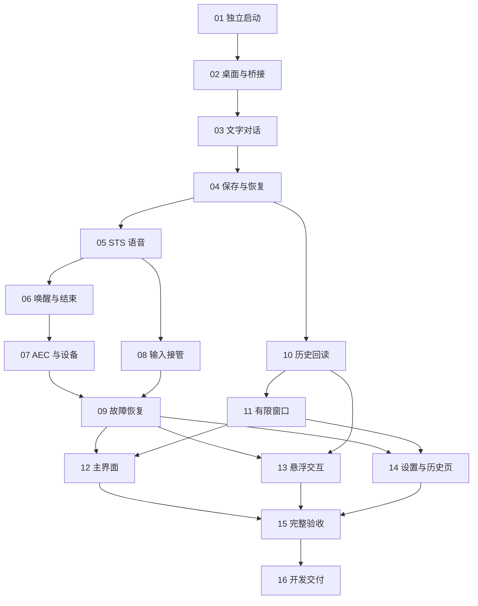

# V1.0.0 实现计划

日期：2026-11-07。

状态（2026-11-09 更新）：阶段 01～04 已完成；阶段 05～07 的实现与自动化验证已完成，真实语音、唤醒、按键、外放声学和设备切换待验收；阶段 08～16 未开始。阶段 06、07 的结果分别见[唤醒记录](../verification/stage-06.md)、[音频设备记录](../verification/stage-07.md)。本计划在已确认的 PRD 和技术架构上，按原 I-01～I-16 一一建立阶段 01～16；每个阶段有独立详细文档和可勾选子任务。

## 1 目标与实施约束

目标是交付可在 Windows 11 x64 开发环境持续使用的完整语音 Agent。依据如下：

- [V1.0.0 PRD](../prd/V1.0.0.md)：功能和 AC-01～AC-39 验收场景。
- [整体技术架构](../design/V1.0.0-architecture.md)：模块职责、STS 接入顺序和 P-01～P-04 验证路径。
- [UI 设计](../design/V1.0.0-ui.md)：主窗口、紧凑收音球和单轮问答框。

沿用已确认方向：Python 与 uv；一个 Python 宿主内 GUI 和 asyncio 后台分线程；pywebview 桥接；React + TypeScript + Vite；Pipecat 先沿用 STS 对应 Git 版本；SQLite 保存完整历史；近期完整内容、有限预览/引用和模型按需回读，首版暂不生成滚动摘要。

详细阶段文档分别列出开始前核对、子任务、可检查结果、交付物、验证步骤及完成条件。完成条件描述后续目标，实际进度以实现和验证记录为准。

## 2 十六阶段总览

原 I 编号保留为追踪编号，验收映射和后续讨论均可继续使用。

| 阶段 | 追踪编号 | 详细计划 | 前置阶段 | 阶段成果 |
| --- | --- | --- | --- | --- |
| 01 | I-01 | [独立工程与开发启动](V1.0.0/01-project-bootstrap.md) | 无 | 独立 uv/前端环境和可运行桌面入口 |
| 02 | I-02 | [桌面常驻、窗口与桥接](V1.0.0/02-desktop-host.md) | 01 | 单实例、托盘、通信和悬浮宿主实测 |
| 03 | I-03 | [真实文字对话与状态事件](V1.0.0/03-text-conversation.md) | 02 | 真实流式文字、连续追问与文字接管 |
| 04 | I-04 | [对话保存与重启恢复](V1.0.0/04-persistence-restart.md) | 03 | SQLite 保存展示和模型消息，正常重启接续 |
| 05 | I-05 | [耳机下的 STS 连续语音链路](V1.0.0/05-sts-voice.md) | 04 | 真实语音、原生轮次、附和和接管 |
| 06 | I-06 | [本地唤醒、结束语音与空闲状态](V1.0.0/06-wake-lifecycle.md) | 05 | 唤醒词、按键、就绪提示、结束与超时 |
| 07 | I-07 | [外放 AEC 与默认设备生命周期](V1.0.0/07-audio-aec-devices.md) | 06 | 外放回声处理、真实音量和设备切换 |
| 08 | I-08 | [文字与未完成语音的接管协调](V1.0.0/08-input-takeover.md) | 05 | 旧输入清理、迟到结果排除和新发言接续 |
| 09 | I-09 | [能力可用性、主动恢复与重新发送](V1.0.0/09-recovery-resend.md) | 07、08 | 语音故障后文字可用、恢复和失败文字重发 |
| 10 | I-10 | [只读历史定位与原文回读](V1.0.0/10-history-tools.md) | 04 | 历史定位、关联原文、分页和原生工具取消 |
| 11 | I-11 | [有限工作窗口与重新开始](V1.0.0/11-context-window.md) | 10 | 预算装载、预览/引用、重新开始和恢复 |
| 12 | I-12 | [主聊天界面与状态操作](V1.0.0/12-main-ui.md) | 09、11 | 选定主界面及正常、错误操作整合 |
| 13 | I-13 | [悬浮收音球与单轮问答](V1.0.0/13-floating-ui.md) | 09、10 | 真正由语音状态驱动的悬浮交互 |
| 14 | I-14 | [设置与历史记录页面](V1.0.0/14-settings-history-ui.md) | 09、11 | 设置生效反馈与独立于工作窗口的历史浏览 |
| 15 | I-15 | [完整流程验收与性能测量](V1.0.0/15-integration-validation.md) | 12、13、14 | 功能联动、设备及性能的实际结果 |
| 16 | I-16 | [独立开发运行与交付说明](V1.0.0/16-dev-delivery.md) | 15 | 新工作副本验证、双击启动及开发版说明 |

## 3 执行顺序与关键验证

默认按阶段 01～16 推进。前置关系允许阶段 08 在基础语音可用后提前验证，阶段 10～11 在文字持久化后提前推进；各阶段完成仍需满足自己的完成条件。后续依赖接入后的复核在各阶段和下方验收表中标明。

### 3.1 架构验证路径的阶段归属

| 验证路径 | 执行阶段 | 需要形成的实际结论 |
| --- | --- | --- |
| P-01 桌面窗口与桥接 | 02；12、13 整合 | 渲染器、透明区域、窗口焦点、跨线程通信与真实 UI |
| P-02 音频与本地唤醒 | 05～07 | 轮次、KWS、ASR 按需连接、AEC、播放参考和设备生命周期 |
| P-03 输入接管与恢复 | 08～09 | 输入归属、旧结果排除、对象交接与文字能力保持 |
| P-04 上下文与历史 | 04、10～11 | 保存表示、查询与引用、工具取消、预算及重启恢复 |

### 3.2 随阶段落实的决策

| 决策 | 落实阶段 | 产出 |
| --- | --- | --- |
| Python 版本及独立依赖安装 | 01 | 版本、Git 来源、锁文件和安装结果 |
| 渲染器、形状与不抢焦点 | 02 | Windows 结果和必要宿主适配 |
| 数据库脚本版本与数据表示 | 04 | 编写脚本前确认版本，保存与恢复说明 |
| KWS 与全局按键实现 | 06 | 词条支持、资源和默认交互实测 |
| AEC 和设备重建 | 07 | 实际选择、采样、参考和重建结果 |
| 文字接管与执行对象交接 | 08～09 | 原生流程接入点与交错/失败验证 |
| 查询、分页及模型预算 | 10～11 | 工具表示、窗口策略和原文回读结果 |
| 实际界面尺寸与性能指标 | 12～15 | 渲染参数、设备条件和测量结论 |

影响已确认产品规则或架构的变更，先形成具体证据和取舍，再与用户讨论。常规技术核查在相应阶段完成，候选方案须以安装、源码或运行结果落实。

## 4 验收覆盖表

“主要阶段”负责交付该项行为，“联动复核”表示在依赖功能接入后补齐完整场景。I-15 汇总结果，I-16 完成最终独立运行检查。

| PRD 验收编号 | 验收主题 | 主要阶段 | 联动复核 |
| --- | --- | --- | --- |
| AC-01 | 启动、重复启动、关闭常驻 | I-02 | I-12 |
| AC-02 | 本地词唤醒与就绪提示 | I-06 | I-13 |
| AC-03 | 默认/自定义按键按住唤醒 | I-06 | I-14 |
| AC-04 | ASR 分句与用户轮次 | I-05 | I-08 |
| AC-05 | 连续补充与追问 | I-05 | I-03、I-08 |
| AC-06 | 附和与上下文过滤 | I-05 | I-07、I-13 |
| AC-07 | 语义接管与回复片段 | I-05 | I-07、I-12、I-13 |
| AC-08 | 转写修订与分类结果对应 | I-05 | I-08 |
| AC-09 | 播报时文字接管 | I-08 | I-12 |
| AC-10 | 语音/文字共享上下文 | I-08 | I-12 |
| AC-11 | 主动结束后接续 | I-06 | I-09 |
| AC-12 | 状态驱动空闲超时 | I-06 | I-10、I-14 |
| AC-13 | 重启及未完成回复恢复 | I-04 | I-09、I-11 |
| AC-14 | 主题/关键词/时间历史回忆 | I-10 | I-11 |
| AC-15 | 历史长正文续读 | I-10 | I-11 |
| AC-16 | 历史不存在或读取失败 | I-10 | I-12 |
| AC-17 | 失败原因与后续操作 | I-09 | I-07、I-12、I-13 |
| AC-18 | 设置生效与失败保留旧值 | I-14 | I-06 |
| AC-19 | 耳机与外放接管 | I-07 | I-15 |
| AC-20 | 文字保持语音激活状态 | I-08 | I-06 |
| AC-21 | 主窗口隐藏/最小化时悬浮显示 | I-13 | I-02 |
| AC-22 | 悬浮隐藏与托盘找回 | I-13 | I-02 |
| AC-23 | 待唤醒收起与下次显示 | I-13 | I-06 |
| AC-24 | 重新开始与旧历史保留 | I-11 | I-12、I-14 |
| AC-25 | 历史读取取消与迟到结果 | I-10 | I-08 |
| AC-26 | 独立项目准备与运行 | I-16 | I-01 |
| AC-27 | 文字历史与必要状态保存 | I-04 | I-05、I-10、I-11 |
| AC-28 | 尚未播报时新语音进入轮次 | I-05 | I-08、I-10 |
| AC-29 | 悬浮新一轮替换 | I-13 | I-08 |
| AC-30 | 判意、附和与接管展示 | I-13 | I-05 |
| AC-31 | 悬浮长回复滚动 | I-13 | I-02 |
| AC-32 | 状态音波与麦克风外环 | I-13 | I-06、I-07、I-10 |
| AC-33 | 文字替代未完成语音 | I-08 | I-09 |
| AC-34 | 语音再问与文字重新发送 | I-09 | I-08、I-12 |
| AC-35 | 准备/播报期间结束语音 | I-06 | I-12、I-13 |
| AC-36 | 默认设备变化与恢复 | I-07 | I-06、I-09 |
| AC-37 | 能力不足时 UI 与文字可用 | I-09 | I-03、I-12、I-14 |
| AC-38 | 可见性对应的错误恢复 | I-09 | I-12、I-13 |
| AC-39 | 历史浏览保持当前上下文 | I-14 | I-11 |

## 5 阶段进度与执行记录

每个阶段开始前阅读详细阶段文档及前置产出。完成子任务后勾选对应编号，并记录实际改动和验证结果；因后续功能尚未接入而需要复核的内容单独保留记录。

每阶段收尾记录：

- 完成日期和实际交付物。
- 关键技术选择、对应源码或实机依据。
- 自动化测试和人工验证结果，以及待联动复核项。
- 未解决问题、影响范围及后续处理阶段。

核心测试聚焦提交/取消顺序、输入交错、状态计时、保存恢复、历史引用与工具取消。窗口焦点、视觉、声学和默认设备通过实际 Windows 环境验证。已通过且没有新变更影响的结果沿用，修复后复测相关项。

阶段 01～04 已完成；阶段 05 的实现与自动化结果见 [语音链路计划及记录](V1.0.0/05-sts-voice.md)，耳机下真实服务联调按用户安排稍后验收。开发启动方式见 [开发运行](../development.md)。子任务勾选表示实际实施进度，完成条件保留尚未完成的实测项。
