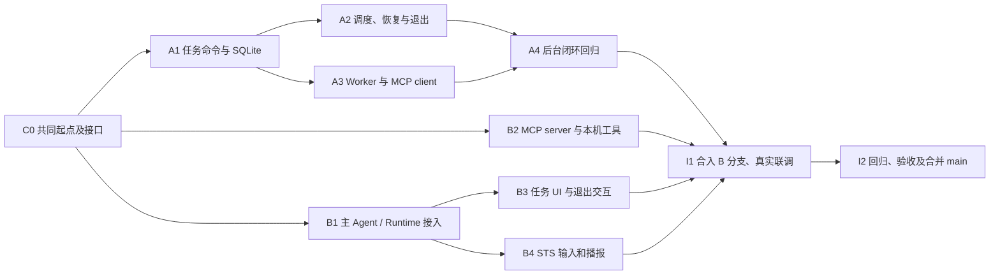

# Voice Super Agent V1.0.1 双人并行施工方案

日期：2026-11-20。依据 [V1.0.1 PRD](../prd/V1.0.1.md) 和 [V1.0.1 技术架构](../design/V1.0.1-architecture.md)。

两人从同一个提交开始，在两条 feature 分支并行施工。开发者 A 交付可独立验证的任务运行时、存储、Worker 和 MCP client。开发者 B 交付主 Agent 接入、内置 MCP server 与本机工具、STS 衔接和桌面界面。A 先完成独立审查，由 B 在桌面任务分支合入 A 完成真实联调。联调通过后将集成分支合入 `main`。

当前 A 分支进度（2026-11-20）：

- 共同起点为 `167ff94`，分支为 `feature/v1.0.1-task-runtime`。
- C0.2 的任务来源、派工计划、摘要、问题、通知、退出进度及执行授权接口已定义在 [tasks/interface.py](../../src/voice_super_agent/tasks/interface.py)，等待 B 分支调用确认。
- C0.5 已获用户许可修改 A 所属的现有存储、依赖及必要测试；迁移编号确认为 `V1.0.1_004__tasks.sql`，SQLite `user_version=4`。提交沿用项目现有 Git 身份。
- A1.2 的新增迁移与任务存储已实现：原消息与整批任务在事务中关联、重复派工返回原批次，执行事实与通知共同提交；支持分页、未读通知和独立并发设置。任务命令、调度恢复及 Worker/MCP 继续分批交付。

## 1 分支与文件归属

| 开发者 | 分支 | 主要产物 | 文件归属 |
| --- | --- | --- | --- |
| A | `feature/v1.0.1-task-runtime` | 任务命令、调度、执行状态、可恢复工作、Worker 模型循环、MCP client 与执行授权 | 新增 `src/voice_super_agent/tasks/`。修改 `memory/store.py` 与其新增迁移脚本。依赖声明及 `uv.lock` 由 A 维护。测试主要在 `tests/test_task_*.py`、`tests/test_worker*.py` |
| B | `feature/v1.0.1-desktop-tasks` | 主 Agent 短命令、任务 UI 和设置、语音输入与反馈、内置 MCP server 和 Windows/文件工具、桌面退出交互 | 新增 `src/voice_super_agent/tooling/`。修改 `runtime.py`、`conversation.py`、`desktop/host.py` 及需要的 `voice/` 文件和 `frontend/`。测试主要在 `tests/test_builtin_tools.py`、`tests/test_task_desktop.py`、前端测试及 STS 接入测试 |

两条分支各有一个文件写入者。任务代码的数据库修改集中给 A。桌面状态与现有对话流程的接入集中给 B。若需要扩展共享接口，由接口所属开发者修改，另一方确认调用行为。依赖包和锁文件各由一人处理，前端依赖归 B。

推荐用两个 Git worktree 各自运行 uv、前端构建和测试。每个工作副本使用自己的临时 SQLite 数据、测试文件和本机配置。桌面原生应用是 Windows 会话级单实例。自动化可并行使用模拟宿主，真实桌面和录音/播放由双方分时使用。

编写任何数据库结构变更前，由 A 提交新增迁移脚本版本号建议请用户确认。现有迁移保持原样。接入涉及现有其他作者代码时，按仓库协作规则列出影响范围并先获得用户许可。Git 提交按用户明确指令执行，提交说明使用中文。

## 2 共同起点与并行工作方式

共同起点包含定稿 PRD、技术架构、施工方案及当前能正常独立启动的 V1.0.0 工程。正式分支建立前完成一次小范围的接口对齐。双方确认类型及行为即可分头开发，接口问题继续通过实际调用与测试反馈调整。

| 编号 | 工作与负责人 | 产物 |
| --- | --- | --- |
| C0.1 | A、B 核对所用共同起点，确认已有语音、文字、SQLite 和 pywebview 的入口 | 两条分支使用同一个 Git 提交。现有配置和测试启动方式已知 |
| C0.2 | A 写任务公共类型，B 确认调用方式 | 计划的 `tasks/interface.py` 包含来源消息、派工计划、任务摘要、问题/答复、状态变化、退出进度与并发设置所需类型 |
| C0.3 | B 写工具公共类型，A 确认调用方式 | 计划的 `tooling/interface.py` 说明 server 工厂及操作目标、范围、步骤与资源标识。A 提供动作授权、占用和结果登记实现。B 的工具处理器通过此接口提交真实结果 |
| C0.4 | A 将 MCP 依赖与仓库依赖联合解析，B 提供最小真实 server 处理函数 | 技术设计已在临时 Python 3.12 环境验证两个会话。此处复现工程内的初始化、发现、调用、取消和关停，记录锁定的 SDK 版本 |
| C0.5 | A 提交迁移版本建议并确认作者许可。B 整理桌面及语音接入的现有代码修改范围 | 与授权相关的文件和版本明确。未依赖迁移或既有接入修改的新增工作可先继续 |

C0.2～C0.4 的公共代码及锁依赖作为两条分支共享的小提交。若准备工作并行进行，先用各自测试中的替身跑通关键路径，公共提交就绪后复用同一份类型。开发中的验收使用功能行为与普通测试。

可让双方同时开工的三个交接点：

- B 用内存任务替身推进聊天卡片、列表详情、问题答复、退出等待和语音反馈。替身只模拟已提交的任务事件及返回值，使用最终桥接命令。
- A 用脚本化模型和 MCP 测试工具推进 SQLite、真实 worker 生命周期和调度，包括可控失败、取消和实际结果核对。
- B 独立通过真实 MCP client 测试内置 server 与临时文件、受控应用和窗口适配器。A 使用相同工具契约验证 worker 到服务端的调用和结果关联。



## 3 A 分支任务

| 编号 | 工作 | 依赖 | 可独立验证的完成条件 |
| --- | --- | --- | --- |
| A1.1 | 任务、执行、步骤、输入、问题与通知模型，明确各状态的合法命令 | C0.2 | 同一任务的排队、执行、等待回答、暂停、取消、失败与结束状态可通过编写普通测试驱动 |
| A1.2 | 新迁移与 SQLite 任务存储，沿用已有 I/O 线程；保存原消息与完整派工批次的关联，持久化并发设置 | A1.1，迁移编号确认和必要许可 | 新库及真实旧库可打开。已有消息、工作窗口及设置仍可访问。重复提交已保存的原消息返回原任务批次 |
| A1.3 | 任务命令、分页和详情，问题回复有明确任务和问题归属 | A1.1，A1.2 | 创建、查询、补充、提问/答复、结束任务关联、同一任务重试均可独立调用。输入按已保存的归属恢复 |
| A2.1 | 并发调度，依据主 Agent 的计划、可用名额和任务依赖派发，处理动态上限与资源冲突 | A1.1，C0.3 | 默认 2 项。调低上限不停止在途工作，等待及暂停后释放名额。同对象冲突的步骤顺序执行 |
| A2.2 | 在途停止意图、步骤发起与结果保存、失败时停止派发 | A1.2，A2.1 | 支持取消的动作实际停止。不可取消动作结束前保持过渡状态。动作成功但结果写入失败时可定位，并暂停后续派发 |
| A2.3 | 重启核对、原任务重试、新执行记录、宿主退出与撤回 | A2.2 | 核对已知、未执行与不确定的动作结果。用户意图优先，保留待回答问题。撤回退出只接续相应中断任务 |
| A3.1 | Worker 的独立上下文与模型请求，执行规划、工具提议、待用户和完成状态 | A1.1，C0.2 | 用可控模型完成多步骤任务，接收后续补充。无需 STS 即可保存和按引用回读任务事实 |
| A3.2 | MCP client 及执行范围、步骤和协议请求的关联，处理多任务、取消、迟到结果 | A3.1，C0.3，C0.4 | 实际发起 MCP 调用。两个任务结果保持正确归属。协议取消与实际动作事实独立处理 |
| A4 | 组装后台闭环及 A 分支端到端测试 | A1～A3 | 从原消息建任务，运行 Worker，落库后恢复。通过重复请求、容量、同资源、暂停/取消中断、结果写入失败和不确定结果场景 |

推荐提交粒度为任务接口、存储与迁移、调度及恢复、Worker 与 MCP client、闭环验证。每项提供可浏览的测试结果和必要的设计备注。A 在完成自身测试后记录所有外部依赖和未完成的真实设备联调。

## 4 B 分支任务

| 编号 | 工作 | 依赖 | 可独立验证的完成条件 |
| --- | --- | --- | --- |
| B1.1 | 在现有 Conversation / Runtime 接入主 Agent 的短任务工具，识别普通聊天、派工、补充、问题答复及控制 | C0.2 | 通过内存任务替身验证普通聊天、任务拆分、上下文归属和含糊时的澄清。主对话取消不会终止已提交任务 |
| B1.2 | 把文本消息和已提交语音轮次绑定到原消息 ID，接入任务请求重发与状态投影 | B1.1 | 任务已创建但聊天失败时重发返回已有任务。重开对话后旧任务的新结果出现在当前会话，重复通知不会二次显示 |
| B2.1 | 内置 MCP server 注册及已确认操作范围约束，提供真实调用结果和恢复核对接口 | C0.3，C0.4 | 使用真实 MCP client 发现并按结构参数调用工具。文件内容、工具返回与历史引用提供的文字不会扩展已确认的目标和路径 |
| B2.2 | 应用定位和复用已有窗口、小博主窗口显示/隐藏 | B2.1 | 受控应用上能区分重复候选、复用和启动。窗口动作在 GUI 线程实际完成后报告结果 |
| B2.3 | 查询目录、读取支持的文本、生成新文件和产物引用 | B2.1 | 临时目录真实展示查询/读取结果。同名时保留已有文件，拒绝越出已确认路径，多任务冲突可由运行时按资源标识调度 |
| B3.1 | 增加桌面桥接、任务卡片/列表/详情、按状态控制、问题回复及并发设置 | B1.1，C0.2 | 用内存任务事件或模拟桥接验证渲染、任务/问题归属、未读状态、重试和上限设置。原设置保存不丢失 |
| B3.2 | 托盘常驻、非阻塞退出等待及撤回，显示进行中的任务/步骤 | B3.1 | 本机宿主在等待期间仍可处理 GUI，能撤回或保存后退出，保存失败保留界面 |
| B4.1 | 将正式语音轮次送给主 Agent，复核原有文字接管、附和和唤醒就绪 | B1.1 | 现有测试入口可验证非推测轮次进入任务流程。附和、未完成输入和迟到帧仍按原规则，主 Agent 的文本/语音回复路径正常 |
| B4.2 | 异步任务结果与问题的播放，按创建来源、忙碌状态、打断与未读规则处理 | B4.1，B3.1 | 模拟 STS 播报下可分别验证主动播报、延后播报、已回待唤醒时转界面未读、打断结果和待答问题优先 |
| B5 | B 分支独立联调，准备真实服务、桌面和设备验收用例 | B1～B4 | 内置 MCP 本机工具、桌面桥接、交互/语音回归各自已通过。可用真实任务接口替换阶段测试中使用的替身 |

B 先推进工具及主桌面两条工作线。STS 变更围绕正式输入、任务工具入口和输出队列，实际音频处理继续沿用现有实现。界面结构沿用原主窗和托盘设计，任务详情、回答和撤回退出各有明确入口。

## 5 合并及联调顺序

1. **各分支独立提交可工作的结果。** A 提交任务运行时、迁移及测试，B 提交桌面模块、MCP server 和测试。双方各评审对方的调用接口，提前修正方法和状态误用。
2. **把 A 分支合入 B 分支。** B 负责 Runtime 的最终装配，将实际 Task Runtime 和内置 MCP 实现连起来。A 负责解决存储、任务状态和依赖上的问题。两人按原文件归属处理冲突。
3. **先联调文字与本机工具。** 从实际输入提交原消息，主 Agent 创建任务，Worker 通过 MCP 在受控目录读写，并更新任务状态与通知。复测任务保存成功后主回复失败的重发。
4. **再联调退出、恢复和语音。** 用真实 SQLite 和 MCP 路径覆盖调低上限、取消期间重启、保存失败与撤回退出。随后验证真实语音发起任务、并行聊天、打断和异步播放。旧版设备及声学实测仍见原清单。 [V1.0.0 实测清单](../verification/stage-15.md#剩余实测)
5. **评审集成结果后合并 `main`。** 两人共同过一遍改动和验收记录。若 `main` 已更新，在 B 分支先接入并复测受影响路径。B 分支包含两条工作线的最终合并结果，由用户指令完成主分支合并。

| 联调任务 | 主责 | 验证结果 |
| --- | --- | --- |
| I1.1 正式装配 | B，A 协作 | 真正的 Task Runtime、MCP session、内置工具和 DesktopApi 协同运行。任务事实在实际提交后展示 |
| I1.2 故障及恢复 | A，B 协作 | 验证跨线程取消、状态及结果关联、意图恢复、撤回退出和投影去重。故障路径采用临时库/临时目录 |
| I1.3 真语音与性能 | B，A 协作 | 真实发言下覆盖 AC-121，记录起止点与设备条件。并发任务运行时采集文字、语音及任务控制指标 |
| I2 完整回归与交付 | A、B | 合并内容的自动化、构建和手动结果记录清楚。前端构建与独立启动可复现 |

## 6 验收分配及执行方式

| 验收编号 | 负责工作及场景 |
| --- | --- |
| AC-101～AC-107 | B1、B4 主责，A1 与 I1.1 联调。覆盖共享对话、真实本机任务、语音接管、附和、补充及任务归属 |
| AC-108～AC-111 | A2、A4 主责。检验动作真实停止、暂停/取消边界、调低上限与名额释放。B3 验证状态和操作入口 |
| AC-112～AC-114 | B1、B3、B4 主责。覆盖异步结果、长任务语音空闲、重开和正常退出，A2 补充明确定义的任务恢复 |
| AC-115～AC-120 | A1、A2、A3、A4 主责。覆核已暂停/取消、重启核对、不确定结果、重试、历史范围及旧库升级 |
| AC-121 | B4、I1.3 主责。真人发起、接管与结果反馈，同时观察正在执行的任务 |
| AC-122～AC-123 | B2 和 A3 共同验证真实 MCP 窗口调用，协议取消后的实际动作及任务状态 |
| AC-124～AC-125 | B3、B4 主责。详情、工具结果和打断之后的展示/播报 |
| AC-126～AC-129 | A2 与 B2 联调。覆盖资源冲突、已有窗口、同名文件保护和内置工具的可用性与生命周期 |
| AC-130～AC-133 | B3、B4 主责，A1、A2 配合。提问、暂停/继续/取消入口、任务历史保留和退出等待 |
| AC-134～AC-137 | A2、B1、B3、B4 联调。撤回退出、已结束任务关联、多任务规划及异步反馈来源 |
| AC-138～AC-140 | A1、A2、B1、I1.2。任务已提交后错误重发，停止过程中重启，以及动作已发生而结果保存失败 |
| AC-141～AC-144 | A2、A3、B2、B3、B4 联调。实际工具范围、多问题归属和恢复名额、最后一步补充与忙碌时延后播报 |

按改动范围运行最有信息量的测试。A 重点运行新任务/模型/存储测试，以及已有存储和上下文测试。B 重点运行新 MCP 工具与桌面测试，保留原 STS、接管、语音恢复和窗口回归。集成时执行一次完整 Python 测试、前端测试与生产构建，再启动真实桌面验证。

```powershell
uv run --locked pytest -q
npm --prefix frontend test
npm --prefix frontend run build
uv run --locked voice-super-agent
```

性能记录覆盖任务接受到已排队、排队到 Worker 开始、停止请求到实际停止，以及异步结果保存到界面展示。保留已确认的 V1.0.0 开发参考值，报告并发任务运行时的对话与语音数据。本地测试与真实音频验收结果分别记录。

完成时记录两条分支的合并位置、自动化与真实验收结果、迁移适用版本、运行方式及已验证的工具限制。若真实音频测试安排尚未完成，验收记录准确列出未执行部分。
