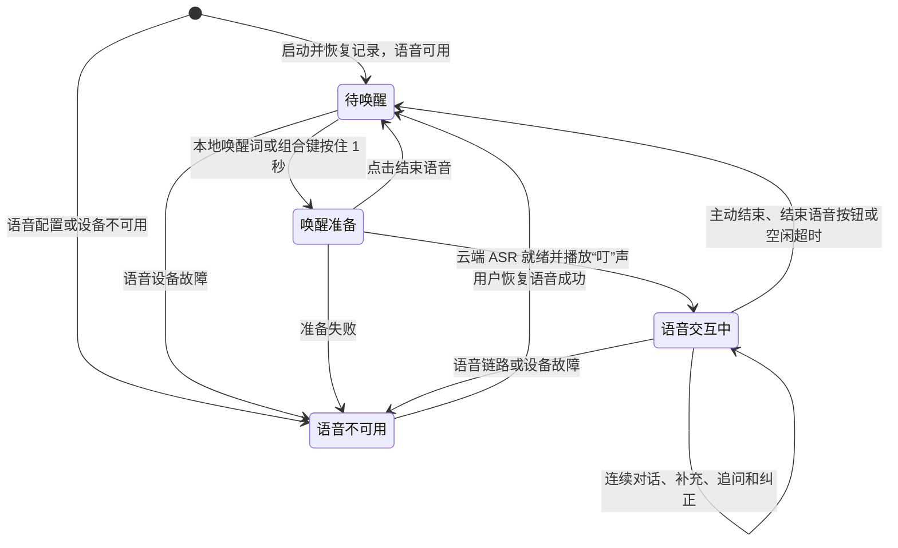

# Voice Super Agent V1.0.0 PRD

| 项目 | 内容 |
| --- | --- |
| 产品 | Voice Super Agent |
| 目标版本 | V1.0.0 |
| 文档状态 | V1.0.0 需求收敛已确认；技术设计、实际渲染与实测待推进 |
| 编写日期 | 2026-11-06 |
| 更新日期 | 2026-11-07 |
| 开发验收环境 | Windows 11 x64，先满足开发环境使用 |

## 1 产品定位与版本目标

Voice Super Agent 是一个运行于 Windows 的常驻语音 Agent。用户手动启动应用后，可以通过唤醒词或自定义组合键进入连续语音交互，也可以在 UI 中输入文字。语音和文字共同连接到同一个 Agent，接续同一份对话历史与上下文。

V1.0.0 的目标是完成可持续使用的对话流程：启动与托盘常驻、唤醒、多轮交流、语义打断、按输入来源回复，以及退出重启后的上下文恢复。模型可以通过只读工具按需读取自身的对话历史。

后端使用 Python，环境与依赖通过 `uv` 管理。桌面宿主采用 pywebview，前端采用 React + TypeScript + Vite。语音流程重点复用 `E:\CodeHub\Agent\sts`，第 5 节列出对应源码、已实现行为和迁移指示。

V1.0.0 先交付可在开发环境日常使用的完整项目，提供手动及双击启动入口。项目维护自己的代码、依赖声明、uv 环境、配置与运行说明，能够脱离旁边的 STS 目录运行。

本文产品规则及主界面、悬浮窗的外观已完成讨论，并于 2026-11-07 确认本轮需求收敛结果，效果图与交互说明见 [V1.0.0 UI 设计](../design/V1.0.0-ui.md)。具体依赖、输入边界协调、故障恢复、音频效果、上下文接口、实际界面参数及性能指标按第 12 节继续设计和验证。

## 2 版本范围

| 编号 | V1.0.0 功能 | 产品要求 |
| --- | --- | --- |
| FR-01 | 启动与后台常驻 | 启动显示主窗口，语音可用时默认待唤醒；重复启动唤出已有窗口，保持单实例；关闭后托盘常驻，最小化按主窗口不可见处理；用户明确退出时结束应用 |
| FR-02 | 唤醒入口 | 默认唤醒词“你好小博”；默认组合键 `Ctrl + \`，按住 1 秒触发；均可配置；ASR 就绪后播放“叮”声，随后接收指令 |
| FR-03 | 连续语音对话 | 支持自然轮次、补充、追问和纠正，按 STS 的现有轮次流程处理 |
| FR-04 | UI 文字对话 | 提供文字输入，展示对话内容与运行状态，和语音共享上下文 |
| FR-05 | 语义打断与输入接管 | 沿用 STS 的语义判断与打断顺序；UI 新消息打断当前回复，并通过新增输入边界协调替代尚未完成的语音，旧转写迟到时不再触发回答 |
| FR-06 | 回到待唤醒 | 支持 Agent 判断主动结束及用户点击“结束语音”；空闲默认 60 秒，可配置为正整数秒，按实际处理状态计时 |
| FR-07 | 上下文连续性 | 再次唤醒、关闭后重新显示 UI、正常退出后重启，均接续既有对话 |
| FR-08 | 自身历史回读 | 允许模型调用只读历史工具，按需取得原文和关联记录 |
| FR-09 | 对话与状态展示 | 展示用户输入、附和、助手回复及处理进度；被打断的回复保留普通文字展示，后台保存处理状态 |
| FR-10 | 交互配置 | UI 配置唤醒词、组合键与空闲超时；无效或应用失败的修改保留该项旧有效值并说明原因；模型服务参数和凭据使用本地 `.env` |
| FR-11 | 失败反馈与恢复 | 界面与历史继续可用，模型具备条件时文字对话继续可用；语音由用户主动恢复后回待唤醒；语音失败由用户再问，UI 文字失败提供重新发送 |
| FR-12 | 悬浮收音窗 | 主窗口隐藏且语音激活时显示圆形收音球，上方圆角框只展示当前一轮问答；新问题或接管时替换，附和保留当前问答；关闭仅隐藏，托盘可找回 |
| FR-13 | 重新开始与历史查看 | 重新开始工作上下文，保留完整旧历史；历史页按时间浏览、按需加载和查看原文，查看历史保持当前工作上下文 |
| FR-14 | 独立开发运行 | 本仓库维护所需代码、依赖和配置，脱离 STS 目录运行 |
| FR-15 | 音频设备 | 跟随 Windows 默认录音和播放设备，按语音状态处理默认设备变化；设备失效后由用户主动恢复 |

V1.0.0 的模型能力包括 Agent 自身对话历史的只读访问，以及表达“结束语音交互”的内部控制动作。后者用于让 Agent 决定结束意图与收尾应答，由后台切换语音状态，动作通道按 T-03 设计。电脑操作、项目控件操作和其他业务工具作为后续演进方向，继续接入统一的用户入口、消息记录和状态展示。

## 3 主要用户场景

| 场景 | 用户行为 | 预期结果 |
| --- | --- | --- |
| 后台使用 | 启动应用后关闭主窗口，在其他软件中工作 | 应用保留托盘入口，并继续响应唤醒 |
| 唤醒交流 | 说“你好小博”，或按住 `Ctrl + \` 1 秒 | ASR 就绪后听到“叮”声，再说指令；释放按键后继续交互 |
| 连续补充 | 得到回答后继续追问“第二个再详细一点” | Agent 结合已有内容回答 |
| 纠正与接管 | 助手播报时说“等一下，我改一下” | 当前生成与播报被打断，接收补充内容并继续交流 |
| 表达附和 | 助手播报时说“嗯嗯，你继续” | 按 STS 语义判断继续当前播报 |
| 切换输入 | 先通过语音提问，再在 UI 中输入“简短一点” | 接续同一上下文，后一次回复以文字展示 |
| 暂停语音交互 | 说“结束对话”、点击“结束语音”，或达到空闲超时 | 回到待唤醒状态，保留历史与上下文 |
| 重新启动 | 明确退出后再次启动应用 | 恢复既有记录和上下文，能够继续交流 |
| 回忆旧内容 | 提问涉及已离开当前模型窗口的历史信息 | 模型可以通过只读历史工具补读相关原文后回答 |
| 桌面收音 | 主窗口隐藏时唤醒，或在交互中关闭收音小窗 | 小窗展示本轮内容；关闭后交互继续，本次激活期间保持隐藏，可通过托盘找回 |
| 重新开始 | 在主界面选择“重新开始”，之后询问以前聊过的内容 | 当前展示和工作上下文重新开始，旧记录保留，Agent 可以查询原文 |

## 4 产品状态与概念

### 4.1 统一 Agent

用户围绕一个持续存在的 Agent 进行交流。产品交互由统一的对话入口、历史内容和运行状态组成；底层上下文标识及内部执行会话由系统管理，用户无需创建、选择或维护 session。

### 4.2 状态分别管理

| 状态维度 | 含义 | 关键规则 |
| --- | --- | --- |
| 应用运行 | 应用运行或已退出 | 用户明确退出才结束进程 |
| 主窗口可见性 | 主窗口显示、隐藏或最小化 | 启动显示主窗口；关闭后继续常驻，最小化按不可见处理；重复启动唤出已有窗口 |
| 悬浮窗可见性 | 自动显示、手动隐藏或手动找回 | 手动隐藏保持到本次激活结束；可从托盘找回；下次唤醒重新按显示规则处理 |
| 语音交互 | 待唤醒、唤醒准备、语音交互中或语音不可用 | 语音可用时启动后待唤醒；ASR 就绪提示后接收指令；结束或超时返回待唤醒；故障由用户恢复成功后回待唤醒 |
| 能力可用性 | 语音、模型与界面的可用情况 | 语音不可用时，具备运行条件的文字对话继续可用；模型配置缺失时仍可查看历史与设置 |
| 回复处理 | 接收输入、处理回复、读取历史、播报、完成、被打断或失败 | 根据真实处理进度向 UI 更新 |
| 对话与上下文 | 完整历史及当前模型使用的工作上下文 | 跨输入来源、语音状态和应用重启接续 |



语音激活阶段包含唤醒准备与连续交互。普通 UI 文字输入保持当前语音状态：待唤醒时仅处理文字，语音已激活时继续保持激活，语音不可用时具备条件的文字对话继续可用。上述状态转换均保留既有对话记录。语音故障发生时，当前可见悬浮组件的错误提示按第 6.7 节处理。

完整历史、UI 当前展示和模型工作上下文分别管理。“重新开始”重置当前展示与工作上下文，旧历史继续保留并支持回读。

## 5 STS 语音流程依据与迁移指示

### 5.1 参考项目与使用原则

语音交互以 `E:\CodeHub\Agent\sts` 当前实现为依据。迁移时应优先复用它的协议适配、原生帧、轮次策略、打断传播和上下文聚合；本地音频、离线唤醒和常驻生命周期在明确接入位置后扩展。

| 参考位置 | 已有职责 | V1.0.0 迁移指示 |
| --- | --- | --- |
| [bot.py](E:/CodeHub/Agent/sts/bot.py:53) | 模型装配、共享上下文、用户与助手聚合器、流水线顺序 | 以现有节点顺序和配置为装配依据，调整桌面应用生命周期 |
| [local_volcengine_services.py](E:/CodeHub/Agent/sts/local_volcengine_services.py:51) | 火山流式 ASR 与 TTS 的协议适配 | 复用转写帧、音频帧与音频上下文标识；按唤醒状态设计 ASR 连接控制 |
| [system_one_interruption.py](E:/CodeHub/Agent/sts/system_one_interruption.py:99) | 播报期间的附和与接管判断 | 沿用分类规则、候选转写修订及结果应用顺序 |
| [LOCAL-RUN.md](E:/CodeHub/Agent/sts/LOCAL-RUN.md) | 当前本地语音方案与运行说明 | 用于核对现有服务组合，源码作为流程细节依据 |

本节链接指向当前工作区的 STS 源码，具体方法定位列于第 5.8 节。`sts` 是参考与复用来源；实现时将所需定制代码纳入本仓库，并通过项目自己的依赖声明提供 Pipecat，具体来源与版本见 T-11。

### 5.2 已有流水线顺序

`sts/bot.py` 中的现有顺序为：

```text
transport.input()
  → VolcengineSTTService
  → SystemOneInterruptionProcessor
  → 用户上下文聚合器 user
  → DeepSeekLLMService
  → VolcengineTTSService
  → transport.output()
  → 助手上下文聚合器 assistant
```

用户和助手聚合器由 `LLMContextAggregatorPair` 创建，共享同一个 `LLMContext`。Silero VAD 配置在用户聚合器中；入口显式使用 `TranscriptionUserTurnStartStrategy` 判起，停止策略沿用默认 Smart Turn。

现有流水线处理参数为输入 16 kHz、输出 24 kHz。Windows 设备采样格式、AEC 和重采样的具体衔接见 T-06。

### 5.3 正常输入与用户轮次

1. 输入音频进入火山 ASR 适配。已定稿的分句发布为 `TranscriptionFrame`，实时识别假设发布为 `InterimTranscriptionFrame`。
2. 助手尚未播报，或用户轮次已经开始时，System One 处理器将转写直接交给下游。
3. 用户聚合器接收音频与转写。已放行转写由原生判起策略开启用户轮次。
4. 用户轮次结束由 Pipecat 的 Smart Turn 与转写等待机制协调，再推进模型回复。

实施指示：ASR 分句定稿与用户轮次结束分别处理。火山结果中的 `definite` 表示识别分句定稿，轮次结束继续由 STS 已采用的 Pipecat 策略决定。

模型正在生成或进行历史回读、助手尚未播报时，新语音沿上述直接通路进入用户轮次与原生打断流程。System One 的附和与接管分类适用于第 5.4 节的播报阶段。

### 5.4 播报期间的语义打断

助手播报期间，`SystemOneInterruptionProcessor` 暂存重叠语音的候选转写，结合共享上下文异步判断意图。

| 判断结果 | STS 当前行为 | 产品要求 |
| --- | --- | --- |
| `backchannel` 附和 | 已定稿且没有待定实时片段时，发布 `UserBackchannelFrame`；用户聚合器按附和事件处理 | 助手继续播报；附和在主界面正常显示并保存到展示历史，悬浮框保留当前问答；沿用 STS 将附和留在模型上下文之外的处理方式 |
| `interrupt` 接管 | 放行候选中的定稿及实时转写，交由原生转写判起策略处理 | 停止当前回复，接收用户的纠正、补充或新问题 |
| `undecided` 意图未明确 | 等待后续转写与修订后继续判断 | 根据完整表达确定接管意图；悬浮框保留当前问答，接管确认后再切换并显示已识别的新发言 |

实施指示：

- System One 用于播报期间的接管判断，普通输入沿用第 5.3 节的直接通路。
- 分类请求异步执行，其他帧继续按现有处理器逻辑流转。
- 候选转写更新后，结果采用应沿用现有的候选与文本对应逻辑。
- 确认接管后，保留已放行输入跨过其自身引发打断的处理方式。
- “嗯嗯”“对”等词结合上下文判断。例如“对，你继续”与“对了，我换个问题”可能表达不同意图。

### 5.5 打断传播与回复提交

在 STS 已采用的路径中，用户聚合器开启用户轮次后广播原生 `InterruptionFrame`。后续模型、合成、输出和助手聚合器分别处理该打断。

迁移应沿用这些已有职责：

- 由原生打断流程协调当前生成、合成及可打断音频的处理。
- 输出模块清理尚在应用队列中的可打断音频，保留原生音频上下文取消语义。
- 助手聚合器在打断时结束当前助手轮次，提交已聚合内容，并发出带有 `interrupted` 状态的轮次事件。
- 后台与持久化记录保存真实轮次状态。主界面与历史保留已展示的回复文字，使用普通消息展示，不添加“已打断”标签；悬浮框按第 6.6 节切换本轮内容。

展示文本、模型提交文本与实际播出的内容具有不同口径。当前火山 TTS 适配只输出音频，未提供词级时间戳；整段 TTS 文本的提交顺序见 `TTSService._speak_text`。记录分别反映真实的展示和提交内容，具体字段与事件订阅按 T-08 设计。

本地播放设备已经接收的缓冲、播放参考流以及中断后的实际停止效果，需要在本地音频适配中验证。AEC 参考应与实际送往播放设备的音频对应。

### 5.6 UI 文字接管的参考顺序

现有 `RTVIProcessor._handle_send_text` 提供了文字接管的顺序依据：

1. 触发当前回复打断。
2. 等待流水线完成相关上下文提交。
3. 配置本轮输出是否经过 TTS。
4. 追加用户文字消息并触发模型处理。

本项目的 pywebview 文字入口应复用这套顺序语义，文字来源的回复选择文字输出。具体采用的桥接接口、帧投递及订阅方式在技术设计中确定。

2026-11-07 补核边界：RTVI 文字消息按接收队列依次处理，`flush_pipeline()` 用探针确认已在流水线中的处理顺序。云端尚未返回的 ASR 转写仍可能随后到达。System One 收到打断时清除当前候选并取消分类，但用户聚合器追加文字时仍可能保有尚未结束的语音聚合；现有实现没有为文字发送建立完整的跨输入截止边界。[文字消息队列](E:/CodeHub/Agent/sts/src/pipecat/processors/frameworks/rtvi/processor.py:281)、[流水线 flush](E:/CodeHub/Agent/sts/src/pipecat/pipeline/worker.py:972)、[候选清理](E:/CodeHub/Agent/sts/system_one_interruption.py:229)、[用户消息追加](E:/CodeHub/Agent/sts/src/pipecat/processors/aggregators/llm_response_universal.py:1392)。

实施指示：本项目新增输入边界协调，使 UI 文字替代发送前尚未完成的语音，该段旧转写迟到时也不再触发回答；之后的新发言按正常语音流程处理。已经提交的历史继续保留。该协调覆盖未结束的语音聚合、尚在队列中及云端在途的转写，具体表示与事件顺序按 T-05、T-08 设计；模型生成、打断与上下文提交继续复用上述 STS 顺序。

### 5.7 本项目新增与需要改造的流程

| 内容 | STS 当前实现 | V1.0.0 明确指示 |
| --- | --- | --- |
| 本地唤醒 | 原生唤醒短语策略依赖 ASR 最终转写 | 新增本地声学关键词检测；待唤醒阶段使用本地检测，唤醒后启用云端 ASR |
| ASR 连接 | 火山适配在 `setup` 时建立云端连接 | 设计与语音激活状态对应的连接生命周期；静音帧只改变处理开关 |
| 空闲结束 | `PipelineWorker` 的默认空闲处理可取消 worker 和 runner | 将产品空闲超时接入待唤醒状态，并保留 Agent 对话与上下文 |
| UI 关闭 | 当前浏览器断开回调取消 runner | 桌面窗口关闭后隐藏，后台应用继续常驻 |
| 交错输入 | 文字打断并 flush 已有流水线；尚未结束的语音及云端在途转写没有统一的文字接管边界 | 按第 5.6 节新增边界协调，满足文字替代未完成语音及旧转写迟到时的处理规则 |
| 能力可用性与故障恢复 | 根 bot 整体装配语音服务，部分永久错误按 CANCEL 策略取消流水线 | 按第 5.10、6.7 节新增桌面可用性与恢复控制，用户恢复语音后回待唤醒 |
| 悬浮收音窗 | 当前入口没有本项目的桌面悬浮窗与隐藏规则 | 新增独立窗口与托盘找回入口，按第 6.6 节管理显示和本次激活内的手动隐藏 |
| 上下文创建 | 当前入口创建内存上下文，连接时注入固定问候 | 从后台恢复并持有统一上下文；窗口显示与既有历史接续 |
| 历史回读 | 当前根目录 bot 尚未装配本项目的历史工具 | 新增自身历史只读能力，沿用第 5.9 节的原生工具打断机制，接口见 T-07 |
| 主动结束 | 根目录 bot 未提供结束意图或返回本地待唤醒的动作，System One 只判断附和、接管与未明确 | 新增 Agent 表达结束意图的内部动作通道，后台执行状态转换；应答由 Agent 决定，按 T-03 设计 |
| 本地音频与 AEC | 当前 SmallWebRTC 从浏览器/Daily 接入音频；本地 PyAudio 实现没有 AEC 或播放参考流 | 在 Python 后台适配采集、播放与 AEC；耳机和扬声器分别实机验收 |
| 默认设备变化 | LocalAudio 在 setup 打开流，start 启动已有流；没有现成的设备变化监听与重开流程 | 按第 6.8 节接入默认设备变化、设备失效反馈及用户主动恢复 |

当前 SmallWebRTC 客户端没有显式配置 AEC 参数；浏览器运行时的回声处理效果需要实测。保留已有轮次流程与本地回声处理适配分别安排验证，详见 [STS 接入方式研究](../research/sts-integration-options.md)。

### 5.8 源码定位

以下为本次核对的源码位置，后续以对应方法及当前源码为准：

| 行为 | 源码位置 |
| --- | --- |
| 共享上下文、轮次配置及节点顺序 | `E:\CodeHub\Agent\sts\bot.py`，第 53 行、第 58 行、第 67 行 |
| ASR 连接与分句转写 | `E:\CodeHub\Agent\sts\local_volcengine_services.py`，`VolcengineSTTService.setup` 第 51 行、`_receive_results` 第 104 行 |
| TTS 音频上下文 | 同文件 `VolcengineTTSService.run_tts`，第 201 行 |
| 接管意图与异步候选处理 | `E:\CodeHub\Agent\sts\system_one_interruption.py`，第 37 行、第 99 行、第 204 行 |
| 转写判起 | `src/pipecat/turns/user_start/transcription_user_turn_start_strategy.py`，第 13 行 |
| 默认 Smart Turn 停止策略 | `src/pipecat/turns/user_turn_strategies.py`，第 419 行 |
| 用户轮次触发打断 | `src/pipecat/processors/aggregators/llm_response_universal.py`，`_on_user_turn_started` 第 1495 行 |
| 助手打断与轮次提交 | 同文件 `_handle_interruptions` 第 2178 行、`_trigger_assistant_turn_stopped` 第 2739 行 |
| 输出缓冲打断 | `src/pipecat/transports/base_output.py`，`MediaSender.handle_interruptions` 第 609 行 |
| 文字接管与上下文提交顺序 | `src/pipecat/processors/frameworks/rtvi/processor.py`，`_handle_send_text` 第 475 行 |
| 原生工具注册与打断 | `src/pipecat/services/llm_service.py`，`register_function` 第 1228 行、打断处理第 1091 行、取消实现第 2323 行 |
| 工具取消写入上下文 | `src/pipecat/processors/aggregators/llm_response_universal.py`，第 2391 行 |
| Agent 状态观察与用户空闲 | `src/pipecat/processors/frameworks/rtvi/observer.py`，`on_push_frame` 第 649 行；`src/pipecat/turns/user_idle_controller.py`，`waiting_for_user` 第 78 行、`wait_for_user` 第 175 行 |
| TTS 文本与音频提交顺序 | `src/pipecat/services/tts_service.py`，`_speak_text` 第 1778 行及第 1987 行；火山适配 `run_tts` 第 201 行 |
| 本地采集与播放 | `src/pipecat/transports/local/audio.py`，第 108 行、第 186 行 |

表中 `src/` 相对路径均以 `E:\CodeHub\Agent\sts` 为根。

### 5.9 历史工具的原生打断机制

Pipecat 的 `register_function` 默认启用 `cancel_on_interruption`。本项目的历史回读沿用该机制：新输入接管时，尚未完成的旧调用随打断取消，已经完成的结果保留，取消后的迟到结果不再推进旧回复。

原生聚合器将被取消调用的结果更新为 `CANCELLED`；打断取消自身默认不再触发旧问题的模型回复。新用户轮次继续处理，需要历史时由模型重新决定读取。

实施指示：历史工具本体、持久化和 UI 状态由本项目接入，取消传播与工具消息顺序复用当前 STS 所用的原生实现。

### 5.10 失败与恢复的源码边界

根 `bot.py` 设置 `ProcessorUnusablePolicy.CANCEL`。火山 ASR 接收任务、火山 TTS 请求与响应流、System One 分类上报的永久错误，会使处理器不可用并触发 worker 取消。ASR 发送异常及模型请求错误还需依据实际分类处理；例如模型认证、权限或无效请求属于永久错误，其他类别不一定取消整条流水线。[根入口策略](E:/CodeHub/Agent/sts/bot.py:79)、[ASR 接收错误](E:/CodeHub/Agent/sts/local_volcengine_services.py:149)、[TTS 错误](E:/CodeHub/Agent/sts/local_volcengine_services.py:242)、[System One 错误](E:/CodeHub/Agent/sts/system_one_interruption.py:107)、[模型异常处理](E:/CodeHub/Agent/sts/src/pipecat/services/openai/base_llm.py:687)。

根入口直接读取三个服务凭据并装配语音链路，ASR 在 setup 建立连接。完成的 worker 在再次 run 时直接返回；当前示例没有本项目要求的能力分开启用、桌面错误页面或用户恢复流程。`LLMContext(messages=...)` 可接收已有消息，为恢复后接续上下文提供接口基础。[入口装配](E:/CodeHub/Agent/sts/bot.py:42)、[worker 完成检查](E:/CodeHub/Agent/sts/src/pipecat/pipeline/worker.py:893)、[上下文构造](E:/CodeHub/Agent/sts/src/pipecat/processors/aggregators/llm_context.py:121)。

实施指示：新增桌面后台的能力可用性与恢复控制。语音故障时保留界面、历史和具备条件的文字对话；用户点击“恢复语音”后，按真实故障范围重建所需运行对象，接续已保存的上下文，成功后回待唤醒。已取消的 worker 通过新对象承接恢复。恢复结果和失败原因按第 6.7 节展示。服务凭据修改仍按重启生效规则处理。

Pipecat 提供 `TTSSpeakFrame(text, append_to_context=False)` 来播报已有文字。V1.0.0 按第 6.7 节采用保留文字、提示播报失败和用户恢复后继续交流的流程，独立重播入口留待后续。当前火山 TTS 未提供词级播放位置。[播报帧](E:/CodeHub/Agent/sts/src/pipecat/frames/frames.py:1050)。产品不自动重复整轮请求的要求与服务 SDK 内部请求重试分别核对，按 T-10 落实实际配置。

### 5.11 本地音频设备的源码边界

LocalAudio 的输入、输出设备索引默认为 `None`，在 `setup()` 调用 `PyAudio.open()` 时把默认设备选择交给 PyAudio；`start()` 仅启动已有流，物理流关闭位于 `cleanup()`。当前实现没有默认设备变更或拔插后的重开机制，Windows 默认设备映射、异常表现及实际迁移效果需要本机验证。[设备参数](E:/CodeHub/Agent/sts/src/pipecat/transports/local/audio.py:34)、[输入打开](E:/CodeHub/Agent/sts/src/pipecat/transports/local/audio.py:68)、[输出打开](E:/CodeHub/Agent/sts/src/pipecat/transports/local/audio.py:147)、[输入启动](E:/CodeHub/Agent/sts/src/pipecat/transports/local/audio.py:96)。

实施指示：新增默认设备变化检测与音频资源重建，按第 6.8 节的时机生效。待唤醒阶段的本地 KWS 采集一并纳入设备生命周期；设备失效时进入明确的不可用状态，由用户恢复。采集、播放、实际播放参考与 AEC 的重建顺序按 T-06 实测确定。

## 6 功能交互要求

### 6.1 启动与托盘常驻

- 提供用户手动及双击启动应用的入口，启动后显示主窗口并恢复记录，语音可用时默认进入待唤醒；配置或设备不可用时按第 6.7 节反馈。
- 应用保持单实例，重复启动唤出已有主窗口，共用同一份 Agent 上下文。
- 运行期间提供系统托盘入口，用户可以显示主窗口、在语音激活且主窗口隐藏时找回收音窗，以及明确退出应用。
- 关闭主窗口后，后台继续运行，语音唤醒和既有对话状态继续可用。
- 最小化按主窗口不可见处理：语音激活时按第 6.6 节显示悬浮组件，待唤醒时收起；本轮已手动隐藏时继续保持隐藏。
- 明确退出时结束应用运行；再次启动时恢复已保存的消息及上下文。
- 本版先满足 Windows 11 x64 开发环境使用，面向其他用户的安装分发按后续交付需求安排。

### 6.2 唤醒与连续语音交互

- 提供一个可配置的中文唤醒短语，默认“你好小博”，通过本地关键词检测触发。
- 全局组合键默认 `Ctrl + \`，支持自定义；持续按住 1 秒触发，释放后继续交互。
- 同一次长按只触发一次；语音已激活时重复唤醒保持当前交互。
- 待唤醒阶段使用本地关键词检测，唤醒后启用云端 ASR。云端 ASR 准备好接收指令后，播放清脆的“叮”声，UI 同步显示就绪。
- 用户先唤醒，收到提示后再说指令；首版按这一步骤组织录音与识别接入。
- 唤醒后支持连续多轮对话，用户可以补充、追问和纠正。
- 起说、轮次结束和播报接管按照第 5 节的 STS 流程迁移。

### 6.3 语音与文字共享上下文

两种输入进入同一个 Agent，按实际输入来源决定该轮回复形式。历史回读属于当前回复的处理过程，最终回复继续沿用该轮输入的来源。

| 输入或切换 | 回复与交互要求 |
| --- | --- |
| 用户语音输入 | 语音回复，同时在 UI 展示文字 |
| 用户在 UI 发送文字 | 在 UI 展示文字回复 |
| 播报过程中收到 UI 新消息 | 按第 5.6 节顺序打断旧回复，结合新文字处理，结果以文字展示 |
| 文字交流后收到用户语音 | 结合既有上下文处理，结果以语音和文字交付 |
| 待唤醒时在 UI 发送普通文字 | 处理文字对话，语音保持待唤醒 |
| 语音激活时在 UI 发送普通文字 | 处理文字对话，语音继续激活，按第 6.4 节重新进入空闲等待 |
| 用户尚未说完时发送 UI 文字 | 文字替代尚未完成的语音，该段旧转写迟到时也不再触发回答；之后的新发言正常处理，已提交历史保留 |
| 语音不可用时发送 UI 文字 | 模型具备运行条件时继续文字对话，语音保持不可用，等待用户恢复 |
| 点击失败文字消息旁的“重新发送” | 在聊天底部追加相同内容，作为新的文字输入，沿普通文字接管规则处理；回复为文字，原记录保留 |

### 6.4 主动结束与空闲超时

用户通过语音表达结束意图，由 Agent 判断并决定是否给出收尾应答，后台执行返回待唤醒。“等一下”“先别说了”等接管表达沿 STS 流程处理；明确的结束意图通过新增内部控制动作落地。该动作通道及其与收尾应答的衔接按 T-03 设计。

用户也可在语音准备或交互期间点击“结束语音”，停止当前回复、播报及相应语音准备，回到待唤醒，保留上下文。主窗口在语音状态旁提供按钮；悬停圆球时左上侧显示结束按钮并提示“结束语音”，右上侧的“×”继续仅隐藏悬浮组件。

空闲超时默认 60 秒，设置值接受大于 0 的整数秒，保持自动超时启用，依据真实处理状态执行：

| 阶段或事件 | 空闲计时规则 |
| --- | --- |
| 语音已激活，正在等待用户继续输入 | 开始计时，包括唤醒就绪后等待第一条指令 |
| 接收用户发言、识别或接管意图判断 | 暂停计时 |
| 模型生成、历史回读或语音播报 | 暂停计时 |
| 语音或 UI 文字新交互处理完成，重新等待用户 | 从配置时长重新计时 |
| 待唤醒时进行 UI 文字对话 | 保持待唤醒 |
| 达到超时时间 | 返回待唤醒，收起悬浮窗，继续托盘常驻 |

返回待唤醒后保留既有历史和上下文，再次唤醒能够接续。监控以 STS 原生用户轮次、模型、工具及播放事件为依据；文字回复结束和唤醒就绪后的等待需要明确接入，原生事件位置见第 5.8 节。

### 6.5 自身历史与只读回读工具

上下文组织参考 Super-agent 的 Inline、Spill 和 Chain of Recall 思路：当前窗口装载相关内容与预览，完整历史在窗口外保存，通过稳定引用继续读取。

- 保存消息原文、来源、时间、处理结果及必要的关联信息。
- 语音与文字交流共同形成可接续的历史记录。
- 文字历史持续保留，默认不保存原始麦克风录音与合成音频。
- 模型需要历史细节时，允许调用只读历史工具。
- 支持根据具体主题、关键词或大致时间线索定位旧对话，线索不足时向用户追问。
- 工具能够根据历史入口取得原文和相关记录；长内容提供分段读取与续读位置。
- 工具读取范围限定为 Agent 自身的对话历史。
- 当前窗口的装载策略与历史工具共同支持接续；具体预算、定位条件及接口见 T-07。
- 历史回读遇到新输入接管时，按第 5.9 节取消未完成调用。
- 历史回读失败或没有找到相关记录时，回复应反映实际结果。

主界面提供“重新开始”和“历史记录”入口。“重新开始”执行以下行为：

1. 停止当前回复，沿用原生打断与提交顺序。
2. 当前聊天展示进入空白状态，当前近期消息及历史预览、引用退出模型工作窗口。
3. 模型从系统指令及后续输入继续工作，并保留历史读取能力。
4. 完整旧历史继续保存，用户可查看；后续问到旧内容时，模型仍可检索和回读。

历史资源引用在重新开始后继续有效。首版工作窗口采用近期完整内容、有限预览与引用，模型按需回读原文，暂不生成滚动摘要。上下文预算、历史增长和召回质量的技术方案见 T-07、T-09。

历史记录页第一版提供按时间浏览、按需加载及查看完整原文。浏览旧记录保持当前工作上下文，返回对话页后继续当前交流。Agent 按主题、关键词和时间线索回读历史的能力按本节执行。

### 6.6 界面与设置

界面以现代化的聊天应用体验为目标，提供统一的消息展示、文字输入、语音交互状态和设置入口。前端采用 React + TypeScript + Vite。已确认采用暖白底、浅杏色消息气泡和琥珀色点缀；主界面与悬浮窗的外观以 [V1.0.0 UI 设计](../design/V1.0.0-ui.md) 中的选定效果图为依据，其余交互细节及桌面适配按 T-01 继续设计和验证。

主界面以对话内容为中心，左侧为对话、历史记录和设置入口，顶部展示 Agent 名称与状态，并提供“重新开始”；语音准备或交互期间在语音状态旁显示“结束语音”，底部提供文字输入。用户头像与“我”在右侧独占一行，消息气泡在其下方；助手名称与图标在左侧独占一行，回复在其下方。失败的 UI 文字消息旁提供“重新发送”，具体行为见第 6.7 节。

| 区域 | 必要信息与操作 |
| --- | --- |
| 对话区域 | 用户语音文字、用户文字消息、附和及助手回复；回复被打断后保留已显示文字，正常展示 |
| 输入区域 | 文字编辑和发送 |
| 状态区域 | 待唤醒、准备、聆听、识别、生成、读取历史、播报与失败等当前状态 |
| 对话管理入口 | 重新开始当前工作上下文、查看历史记录 |
| 设置入口 | 唤醒词、组合键、空闲超时时间的配置 |
| 托盘入口 | 显示主窗口、在符合显示条件时找回收音窗、明确退出应用 |

悬浮收音窗采用右下方的紧凑圆形收音球，中央使用音波动画：聆听时随用户声音起伏，安静时收为短音柱；准备、识别、思考或读取历史时小幅、缓慢地循环起伏；播报时随实际播放的声音起伏。外环始终以亮起的弧长反映麦克风收音大小，声音越大弧线越满，助手播报期间也继续反映麦克风输入。

准备和识别阶段，在圆球下方短暂显示“正在准备”或“正在识别”，阶段结束后收起相应提示；语音就绪时播放“叮”声。主窗口在顶部状态区域同步展示对应状态。失败反馈按第 6.7 节执行，实际动画节奏与排版按 T-01 验证。

用户开始提问时，在收音球上方自动出现圆角矩形对话框，显示本轮识别文字和逐步生成的回复。框内用户发言使用靠右的浅杏色气泡，助手回复在暖白底上靠左展示，通过底色和位置区分双方。悬浮框省去头像和姓名标签。

悬浮框只展示当前一轮问答：本轮结束后保留内容；新的问题或真正接管进入用户轮次时，替换上一轮展示。播报期间沿用 STS 语义判断，判意期间保留当前问答，接管确认后再切换并显示已识别的新发言；附和保留当前问答，附和记录进入主界面与历史。其他阶段按原生用户轮次事件切换，轮次边界依照第 5 节处理。

替换只改变悬浮框的展示范围，完整历史与 Agent 上下文继续保留。附和仍在主界面正常显示并保存到展示历史。

长回复达到对话框最大高度后在框内滚动，默认跟随最新生成的内容。用户主动向上滚动阅读时暂停跟随，保留当前阅读位置；用户回到底部后恢复跟随。最大高度的具体数值在实际界面中落实，见 UI 设计文档。

鼠标悬停收音球时，圆球右上侧显示小“×”按钮，语音准备或交互期间左上侧显示结束按钮并提供“结束语音”提示；指针位于圆球或任一按钮区域时保持按钮可见，移出后收起。点击“×”同时隐藏收音球与上方对话框，语音接收、回复和空闲规则继续运行；结束按钮按第 6.4 节处理。

| 条件或操作 | 悬浮窗行为 |
| --- | --- |
| 主窗口显示 | 交互信息由主窗口承载，悬浮窗收起 |
| 主窗口最小化 | 按主窗口不可见处理，继续遵守语音状态及本轮手动隐藏规则 |
| 主窗口隐藏，处于唤醒准备或语音交互，且本次激活未保持手动隐藏 | 自动显示，在普通桌面置顶；自动出现时保持当前应用的键盘焦点 |
| 点击收音球悬停时出现的“×” | 同时隐藏圆球与对话框；语音接收、当前回复和空闲规则继续运行 |
| 点击“结束语音” | 停止当前回复、播报及相应准备，返回待唤醒并收起悬浮组件，保留上下文 |
| 本次激活期间已手动隐藏，发生新发言或新回复 | 保持隐藏 |
| 主窗口隐藏且语音激活，用户从托盘选择“显示收音窗” | 手动找回窗口 |
| 回到待唤醒 | 自动收起 |
| 下一次从待唤醒进入语音激活 | 重新按上述显示规则处理 |
| 当前语音链路或设备失败 | 按第 6.7 节保留当前可见组件并展示错误与恢复入口；已手动隐藏时保持隐藏 |

模型上下文与 UI 展示分别使用适合的消息投影。被打断的回复在主界面与历史中使用普通文字展示，后台保留真实状态；附和在主界面正常显示并保存到展示历史，在模型上下文中继续按 STS 的附和规则处理。悬浮框遵循上述单轮展示规则。具体记录表示和事件接入按 T-08 设计。

配置与生效时机如下：

| 配置 | 提供方式 | 生效规则 |
| --- | --- | --- |
| 唤醒组合键 | UI 设置，默认 `Ctrl + \` | 保存后生效 |
| 空闲超时 | UI 设置，默认 60 秒，接受正整数秒 | 保存后使用新值；当前已在等待用户时重新计时，处理完成后按新值进入等待 |
| 中文唤醒短语 | UI 设置，默认“你好小博” | 下一次进入待唤醒时应用 |
| ASR、DeepSeek、TTS、System One 服务参数与凭据 | 本地 `.env`，项目提供配置示例 | 重启应用后生效 |

设置不合法或应用失败时，显示具体原因，明确此次修改未生效，并保留该项原来已生效的配置；用户修正后重新保存。超时输入按正整数秒校验，唤醒词按选定模型的支持范围处理，组合键不可用时反馈原因；可可靠检测的冲突范围由 T-02 验证。

### 6.7 失败反馈

设备访问、ASR、模型、System One、TTS 或历史读取失败时，展示可理解的原因并保留已有记录，应用继续常驻。语音准备失败或语音能力不可用时，界面、历史与设置继续可用；模型具备运行条件时，文字对话继续可用。模型配置也缺失时，仍可查看历史和设置。服务参数与凭据的修改按 `.env` 重启生效规则处理。

| 当前界面状态 | 语音错误与恢复入口 |
| --- | --- |
| 主窗口可见 | 在状态区域显示原因和“恢复语音” |
| 悬浮组件可见 | 保留当前问答，在对话框内增加简短错误说明和“恢复语音”；失败提示作为状态展示 |
| 悬浮组件已被用户手动隐藏 | 保持隐藏，通过托盘状态提示异常，用户打开主窗口后恢复 |

用户点击“恢复语音”后，按当前已生效配置和 Windows 默认设备恢复所需语音运行链路；成功后回到待唤醒，按既定规则收起悬浮组件，保留历史与上下文。用户再次唤醒后继续交流。失败原因及恢复结果应明确反馈。

本版采用用户主动恢复，不自动重复整轮请求。失败后的后续交互按输入来源处理：

- 语音提问失败：保留已有内容，由用户恢复必要服务后再问一遍或继续提问。
- UI 文字提问失败：在原用户消息气泡旁提供“重新发送”。点击后在聊天底部追加相同内容，作为新的文字输入处理，回复仍为文字；原消息与已有回复片段保留。普通文字接管和语音状态规则继续适用。
- TTS 播报失败：保留已有文字并提示原因，用户恢复语音后继续交流；独立的已有文字重播入口留待后续版本。

已经保存的内容与必要处理状态继续保留；正常退出重启后恢复记录，语音可用时进入待唤醒，由用户继续输入。STS 错误传播与取消事实见第 5.10 节，本项目的能力可用性、恢复和重新发送由 T-10 适配并验证。

### 6.8 音频设备

V1.0.0 跟随 Windows 默认录音与播放设备，设备变化按当前语音状态处理：

| 条件 | 处理规则 |
| --- | --- |
| 待唤醒时默认设备变化 | 采用新的默认设备，继续本地唤醒检测 |
| 正在语音交互，默认设备变化且旧设备仍可用 | 当前交互继续，下一次唤醒采用新的默认设备；返回待唤醒后，本地采集按待唤醒规则管理 |
| 旧设备已失效 | 明确提示语音设备不可用，由用户点击“恢复语音”，重新打开当前默认设备；成功后回待唤醒 |

待唤醒阶段也依赖麦克风运行本地关键词检测，设备失效后的状态与恢复入口按第 6.7 节处理。默认设备解析、变化检测及采集/播放/AEC 的重建属于新增适配，源码边界见第 5.11 节，技术验证见 T-06。

## 7 关键用户流程

### 7.1 语音对话后切换文字

1. 用户唤醒 Agent，提出语音请求。
2. Agent 按 STS 轮次流程处理并开始语音回复，UI 展示对应内容。
3. 用户在 UI 发送补充文字。
4. 当前回复被打断，流水线先提交相关上下文，再追加文字消息。
5. Agent 结合先前内容和新输入回答，新的回复在 UI 中以文字展示。

### 7.2 主动结束后接续

1. 用户进行多轮交流。
2. 用户表达结束语音交互的意图。
3. Agent 判断结束意图并决定收尾应答，后台执行返回待唤醒，保留记录与上下文。
4. 用户再次唤醒并提出关联问题。
5. Agent 使用既有上下文；需要补充原文时调用只读历史工具。

### 7.3 正常退出后恢复

1. 用户完成对话，并通过明确退出入口结束应用。
2. 应用完成正常退出所需的状态保存与资源结束。
3. 用户重新启动应用。
4. 后台恢复已保存的消息、必要处理状态与上下文，显示主窗口并恢复退出前的当前展示范围；语音可用时进入待唤醒，不可用时显示原因。
5. 用户通过语音或文字继续交流。

退出时尚未完成的回复保留已有记录，由用户继续输入；失败后的重发与恢复按第 6.7 节处理。

### 7.4 历史回读

1. 当前输入需要补充已有历史信息。
2. 模型根据当前上下文中的入口或历史定位结果请求读取。
3. 后台返回有限原文、对应引用及续读信息。
4. 模型按需继续展开相关记录，再生成回复。
5. 回复按照本轮输入来源展示或播报。

### 7.5 隐藏悬浮窗后继续交互

1. 主窗口隐藏，用户唤醒 Agent，悬浮窗显示准备与就绪状态。
2. 用户收到“叮”声后发出指令，圆球上方的圆角框显示本轮识别与回复；新问题或接管时替换上一轮展示，附和保留当前问答。
3. 用户将鼠标移到收音球上，点击右上侧出现的“×”，圆球与对话框同时隐藏，语音交互继续。
4. 后续发言和回复保持窗口隐藏；需要时从托盘找回。
5. Agent 主动结束或空闲超时后回到待唤醒；下次唤醒重新按显示规则处理。

### 7.6 重新开始后查询旧内容

1. 用户选择“重新开始”，当前回复停止，聊天展示进入空白状态。
2. 模型工作上下文从系统指令和后续输入开始，完整旧历史继续保存。
3. 用户询问以前讨论过的主题或某个时间段的内容。
4. Agent 定位历史并调用只读工具回读原文，再根据当前输入来源回复。

## 8 数据与上下文要求

| 数据 | 用途 | 需求 |
| --- | --- | --- |
| 展示与消息记录 | UI 展示、历史回读和关联定位 | 保留稳定标识、时间、来源、文本及真实状态；展示文本与模型提交文本按各自口径保存或还原 |
| 上下文恢复状态 | 退出重启后继续交流 | 恢复当前模型工作上下文、展示范围及历史引用；保留重新开始后的工作范围，具体表示待设计 |
| 关联记录 | 从概要、预览或当前输入定位相关原文 | 引用能对应到实际保存的消息或片段 |
| 用户交互配置 | 唤醒和空闲控制 | 保存唤醒词、组合键和超时时间，按第 6.6 节应用 |

上下文装载与完整历史存储分别管理。文本被截取或移出当前窗口后，读取入口仍能够对应到完整记录。

文字历史持续保留，默认不保存原始录音与合成音频。“重新开始”改变当前展示和工作上下文，保留完整旧历史及其读取入口。

中断与完成状态和 STS 助手轮次提交对应。后台保留未完成记录，重启后由用户继续或重试；具体字段、保存时机和工具消息表示按 T-08 设计。

## 9 技术架构约束与选型状态

| 项目 | 状态 | 约束或候选 |
| --- | --- | --- |
| 后端语言与环境 | 已确定 | Python；使用 `uv` 管理依赖与环境 |
| 桌面宿主 | 已确定 | pywebview，使用内嵌 Web 界面 |
| 前端框架与构建 | 已确定 | React + TypeScript + Vite |
| 开发交付 | 已确定 | Windows 11 x64 开发环境；独立项目，自己的代码、依赖、uv 环境、配置与运行说明 |
| 语音流程与服务组合 | 已确定 | 重点复用 STS；火山 ASR、DeepSeek、火山 TTS、System One；轮次与打断按第 5 节 |
| 音频接入方向 | 已确定 | 接受本地音频适配，由后台管理语音能力 |
| 唤醒方式 | 已确定 | 本地关键词检测，唤醒后启用云端 ASR；同时支持全局按键唤醒 |
| 桌面运行与音频设备 | 已确定产品规则，适配待实现 | 单实例、启动显示主窗口、最小化按不可见处理；跟随 Windows 默认设备，按第 6.8 节切换与恢复 |
| 输入边界与故障恢复 | 已确定产品规则，适配待实现 | 文字替代未完成语音；语音不可用时保留具备条件的文字能力，主动恢复成功后回待唤醒；源事实见第 5.6、5.10 节 |
| 历史工具范围 | 已确定 | 只读 Agent 自身对话历史 |
| 主动结束控制 | 已确定产品职责，通道待设计 | Agent 判断结束意图与收尾应答，后台执行返回待唤醒；本项目新增内部控制动作 |
| Windows 渲染器 | 候选 | WebView2 |
| 音频与 AEC | 候选 | 以 Pipecat 本地音频接入为起点，验证 `pywebrtc-audio` AEC3 等方案 |
| 本地关键词检测 | 候选 | `sherpa-onnx` KWS；具体模型待确定 |
| 数据存储 | 已确定 | SQLite，保存完整历史和当前工作窗口 |
| 工作上下文组织 | 已确定方向 | 近期完整内容 + 有限预览/引用 + 模型按需回读；首版暂不生成滚动摘要，具体预算按 T-07 设计 |
| 全局按键实现 | 候选 | `pynput` |
| 运行与前后端通信 | 已确定方向，接口待设计 | 一个 Python 宿主，GUI 与 asyncio 后台分线程，使用 pywebview 桥接传递命令、消息和状态 |
| Pipecat 依赖来源 | 已确定接入方向 | 先沿用 STS 对应的 Git 版本，使用本项目独立 uv 环境；安装与接口兼容性按 T-11 验证 |

后台持有 Agent 的消息、上下文和处理状态，前端负责输入与展示。UI 可见性、语音激活和应用退出分别由对应职责管理。

现有 STS 以本地 editable 源码安装 Pipecat，安装元数据为 `1.15.0`，现有 Python 环境为 3.12。2026-11-07 补核 Git 来源为 Pipecat 仓库的 `de8998789`，描述为 `v1.14.0-385-gde8998789`。本项目已选择先沿用这份开发分支的 Git 版本，按 T-11 验证独立安装与接口兼容性；Python 具体版本按架构文档建议核对。

根目录定制语音模块需要迁入本仓库；它们随本项目代码维护。项目依赖与资源通过自己的环境和说明准备，运行时脱离 STS 目录及其 `.venv`。

## 10 非功能要求

### 10.1 交互一致性

- UI 对话与后台处理使用同一份事实记录，切换输入来源后能接续内容。
- 附和、接管、结束语音交互和退出应用具有明确的不同处理结果。
- 历史工具返回结果继续服务于发起该轮回复的上下文与输入来源。
- 主窗口、悬浮窗和模型上下文按真实事件更新，各自展示或提交适合的文本口径。

### 10.2 运行与持久化

- 主窗口隐藏时，常驻、唤醒和语音能力继续运行。
- 悬浮窗关闭仅隐藏；本次激活期间保持手动隐藏状态，允许从托盘找回。
- 正常退出后重新启动，已保存的对话与上下文可恢复。
- 重新开始后的展示范围和工作上下文可恢复，旧历史仍可查询。
- 并发到达的输入、打断与历史读取结果复用 STS 的提交、取消与工具结果处理；文字接管未完成语音的跨输入边界按第 5.6 节新增协调。
- 语音不可用时界面与历史继续可用，具备条件的文字对话继续运行；用户恢复语音成功后回待唤醒。
- 从本仓库的代码、依赖声明和配置示例准备环境，能够脱离 STS 目录启动和运行。

### 10.3 音频体验

- 本地音频适配应支持助手播报期间继续接收用户语音并进行语义接管。
- 扬声器播放参考、AEC 与采集音频的衔接纳入设备验证，确保能够区分助手回声与用户发言。
- 耳机和电脑扬声器分别验证；当前 STS 的浏览器链路和本地 PyAudio 接口作为实现参考，实际声学效果通过本机测试确定。
- 跟随默认设备，覆盖待唤醒时切换、交互期间延后切换及设备失效后的主动恢复；本地 KWS 采集纳入同一设备生命周期。
- 实际播放停止效果包括应用缓冲与设备缓冲的影响，量化目标在 T-12 确定。

### 10.4 需测量的指标

| 指标 | 测量内容 |
| --- | --- |
| 唤醒响应 | 本地关键词检测或组合键触发，到 ASR 就绪并播放提示音的时间；分别记录 1 秒按住阈值和后续准备耗时 |
| 首次回复 | 用户轮次结束到首段文字、首段可听音频的时间 |
| 接管响应 | 用户开始表达接管意图、分类完成、原生打断及实际停止播放的时间 |
| 历史回读 | 工具读取和追加模型往返的耗时，以及原文回读的正确性 |
| 常驻资源 | 待唤醒、交互和界面隐藏期间的 CPU 与内存占用 |

组合键按住阈值 1 秒、默认空闲超时 60 秒为已确认的产品参数。其余性能数值与具体测试设备在 T-12 中测量和确定。

## 11 验收场景

| 编号 | 关联需求 | 场景 | 通过标准 |
| --- | --- | --- | --- |
| AC-01 | FR-01 | 手动启动、重复启动并关闭主窗口 | 启动显示主窗口，语音可用时默认待唤醒；重复启动唤出同一实例；关闭后托盘保留，后台继续运行，能再次显示窗口 |
| AC-02 | FR-02 | 待唤醒时说“你好小博”或有效配置的唤醒词 | 本地检测后准备云端 ASR；就绪后播放清脆“叮”声并展示就绪状态，随后接收指令 |
| AC-03 | FR-02 | 在其他应用获得焦点时按住默认 `Ctrl + \` 或自定义组合键 | 持续按住 1 秒触发；同次长按触发一次，松开后继续交互；语音已激活时重复唤醒保持当前交互 |
| AC-04 | FR-03 | 一段用户表达包含多个 ASR 定稿分句 | 用户轮次按 STS 的 Smart Turn 与转写等待机制处理 |
| AC-05 | FR-03、FR-07 | 连续补充和追问 | 回答衔接此前内容，无需重新交代已知信息 |
| AC-06 | FR-05、FR-09 | 助手播报时说“嗯嗯，你继续” | 附和正常展示并保存到展示历史；助手继续播报，附和在模型上下文中按 STS 过滤 |
| AC-07 | FR-05、FR-09 | 助手播报时说“等一下，我改一下” | 识别接管并触发原生打断；UI 正常保留已显示回复文字，后台保存真实状态，接收后续输入 |
| AC-08 | FR-05 | 重叠转写由不完整片段修订为明确接管表达 | 使用与当前转写对应的分类结果，放行有效输入 |
| AC-09 | FR-04、FR-05 | 播报期间在 UI 发送新文字 | 按打断、提交、追加输入的顺序处理，新回复为文字 |
| AC-10 | FR-04、FR-07 | 语音和 UI 文字交替追问同一内容 | 共用上下文，回复形式跟随各轮输入来源 |
| AC-11 | FR-06、FR-07 | 通过语音主动结束后再次唤醒 | Agent 判断结束意图并决定收尾应答，后台返回待唤醒并继续常驻，再次交流衔接已有内容 |
| AC-12 | FR-06 | 使用默认 60 秒及修改后的超时，覆盖首轮等待、生成、回读和播报阶段 | 仅等待用户时计时；处理阶段暂停，新交互处理完成后重新计时；到期回待唤醒并保留上下文 |
| AC-13 | FR-07、FR-11 | 正常退出后重启，包括存在未完成回复的情况 | 恢复已有内容、状态与当前展示范围，默认待唤醒，由用户继续或主动重试 |
| AC-14 | FR-08 | 按主题、关键词或大致时间询问已离开当前窗口的原文 | 模型定位历史后通过只读工具读取原文与关联信息；线索不足时追问 |
| AC-15 | FR-08 | 历史内容需要分段读取 | 返回续读入口，后续读取能够衔接到完整原文 |
| AC-16 | FR-08、FR-11 | 历史不存在或读取失败 | 返回真实结果，UI 展示相应状态，回复反映读取结果 |
| AC-17 | FR-09、FR-11 | 设备、ASR、System One、模型或 TTS 失败 | 展示原因并按输入来源提供恢复或重新发送入口，应用继续常驻，保留已有内容；TTS 失败保留已有文字；不自动重复整轮请求 |
| AC-18 | FR-10 | 修改组合键、正整数超时、唤醒词及 `.env`，并提交无效或无法应用的设置 | 有效设置按既定时机生效；无效或应用失败时显示原因并保留该项旧有效配置；超时只接受正整数秒；服务配置重启生效 |
| AC-19 | FR-03、FR-05 | 分别在耳机和扬声器下播报，先保持安静，再真实发言接管 | 验证回声处理和真实语音接管效果，记录设备条件与响应耗时，按 T-06、T-12 验收 |
| AC-20 | FR-04、FR-06 | 分别在待唤醒和语音激活状态发送普通 UI 文字 | 回复为文字；原语音激活状态保持，激活时在处理完成后重新计时 |
| AC-21 | FR-01、FR-12 | 主窗口隐藏或最小化时唤醒并发言，再显示主窗口 | 两种不可见状态按同一规则显示悬浮组件，外环随麦克风音量变化，圆角框显示本轮识别和回复；自动出现不抢焦点，手动隐藏规则继续有效；主窗口恢复后承载信息 |
| AC-22 | FR-12 | 悬停收音球并点击“×”，继续发言或接收回复，再从托盘找回 | 悬停显示右上侧“×”，指针移到按钮时仍可点击；点击同时隐藏圆球与对话框，交互继续，本次激活期间保持隐藏；托盘可手动重新显示 |
| AC-23 | FR-06、FR-12 | 回待唤醒后再次唤醒 | 小窗在待唤醒时收起，下次激活重新按主窗口可见性等规则显示 |
| AC-24 | FR-08、FR-13 | 选择“重新开始”，查看历史并询问旧内容，随后退出重启 | 当前回复停止，展示和工作上下文重新开始；旧记录可查看和回读；重启恢复重新开始后的工作范围 |
| AC-25 | FR-05、FR-08 | 历史读取中通过语音或 UI 新输入接管 | 按 STS 原生机制保留已完成结果、取消未完成调用，迟到结果不推进旧回复；模型按新输入决定是否重读 |
| AC-26 | FR-14 | 按本仓库说明准备代码、资源、环境与配置，脱离 STS 目录启动 | 独立 uv 环境和显式依赖可支持启动与正常语音、文字流程 |
| AC-27 | FR-08、FR-09、FR-13 | 语音、文字、附和及助手回复形成历史，再重新开始 | 文字和必要状态持续保存，默认不保存原始录音或合成音频；旧历史引用继续可读 |
| AC-28 | FR-03、FR-05 | 模型生成或历史回读期间，尚未开始播报时收到新语音 | 转写沿 STS 直接通路进入用户轮次与原生打断流程 |
| AC-29 | FR-09、FR-12 | 悬浮框完成一轮问答后，用户再次提问 | 旧问答保留到新一轮进入后再被替换，悬浮框只显示新一轮；主界面与历史保留旧内容，上下文继续接续 |
| AC-30 | FR-05、FR-09、FR-12 | 悬浮框展示回复时，先附和，再表达接管，覆盖判意未完成阶段 | 判意期间保留当前问答；附和继续播报并保存至主界面和历史；确认接管后沿原生打断切换并显示已识别的新发言 |
| AC-31 | FR-12 | 悬浮框持续生成超过最大高度的回复，用户上滚阅读后再回到底部 | 对话框达到最大高度后内部滚动，默认跟随最新内容；手动上滚后新增文字保留当前阅读位置，回到底部后恢复跟随 |
| AC-32 | FR-12 | 依次进入准备、识别、聆听、思考/读取历史和播报状态，播报时用户发声 | 准备/识别时音柱缓慢小幅循环并短暂显示对应文字，阶段结束收起提示；聆听随用户声音变化，安静时收为短柱；思考/回读缓慢小幅循环；播报随实际播放声音变化，外环始终反映麦克风输入 |
| AC-33 | FR-04、FR-05、FR-07 | 语音已有分句但尚未结束时发送文字，并让旧 ASR 结果迟到；随后再发起新的语音 | 文字替代该段未完成语音，迟到的旧转写不再触发回答；已提交历史保留；之后的新发言正常进入语音流程 |
| AC-34 | FR-04、FR-09、FR-11 | 分别使语音与 UI 文字回答失败，随后继续输入或点击重新发送 | 语音由用户再问；失败 UI 文字消息旁提供重新发送，点击在底部追加相同内容并产生文字回复；原消息与回复片段保留，普通文字接管规则继续适用 |
| AC-35 | FR-06、FR-12 | 语音准备及播报期间，分别通过主窗口和圆球悬停入口结束语音 | 主窗口状态旁与圆球左上侧的结束入口可用；停止当前回复、播放或准备，回待唤醒并保留上下文；右上侧“×”仍只隐藏 |
| AC-36 | FR-11、FR-15 | 待唤醒时改变默认设备；交互中改变默认设备但旧设备可用；使当前设备失效 | 待唤醒采用新默认设备并继续本地 KWS；交互中旧设备可用时延后采用；设备失效明确提示，用户恢复时重新打开当前默认设备，成功后回待唤醒 |
| AC-37 | FR-01、FR-04、FR-11 | 语音配置或设备不可用时启动；分别检查模型可用和模型配置缺失两种情况 | 主窗口、历史与设置可用，说明语音不可用原因；模型具备条件时文字对话可用；模型配置也缺失时仍可查看历史与设置 |
| AC-38 | FR-07、FR-11、FR-12 | 语音链路失败，覆盖主窗口可见、悬浮组件可见及已手动隐藏，再主动恢复 | 在当前可见界面显示原因与恢复入口，悬浮框保留已有问答；已手动隐藏时保持隐藏并通过托盘状态提示；恢复成功回待唤醒，保留记录与上下文，由用户再次唤醒 |
| AC-39 | FR-07、FR-13 | 进入历史页浏览、按需加载并打开旧原文，再返回当前对话 | 原文可查看，浏览操作保持当前工作上下文，返回后继续当前交流 |

## 12 后续设计与验证任务

本轮需求收敛已经用户确认，产品规则按前文执行。下表保留原讨论编号，将剩余工作落实为技术设计、实际渲染和验证任务；候选技术和实测结果在对应任务完成后更新。历史与设置页面的功能边界已确定，其排版继续按 UI 设计文档落实。

| 编号 | 主题 | 已确定边界与剩余工作 |
| --- | --- | --- |
| T-01 | 界面与桌面宿主 | 视觉、状态提示、结束/隐藏/恢复入口、单轮展示、滚动、历史浏览及重发规则已确定；落实页面排版、动画节奏、尺寸与 DPI，验证 WebView2 候选、单实例、窗口唤出、最小化、置顶与焦点 |
| T-02 | 组合键接入 | 默认 `Ctrl + \`、按住 1 秒及重复触发规则已确定；验证键盘布局、全局监听和冲突反馈，确定具体实现库 |
| T-03 | 结束动作与计时接入 | Agent 决定结束及收尾、UI 结束语音、正整数超时默认 60 秒和状态驱动规则已确定；设计内部动作、准备取消及应答衔接，接入真实轮次、模型、工具和播放事件 |
| T-04 | 配置管理 | 配置入口、生效时机、正整数超时及失败保留旧值已确定；设计保存与应用方式，核对唤醒词支持范围和错误反馈，提供 `.env` 示例 |
| T-05 | 初始与跨入口验证 | 启动显示主窗口、普通文字保持语音状态及文字接管未完成语音已确定；设计跨输入边界，验证既有聚合、队列与迟到 ASR，覆盖新发言、连续文字及重新发送 |
| T-06 | 本地音频与 KWS | 本地检测、提示后发言及默认设备切换/恢复规则已确定；验证采样、AEC/播放参考、中文 KWS 和“你好小博”，接入默认设备变化、流重建、ASR 按需连接及原生轮次 |
| T-07 | 上下文与回读接口 | 关键词/主题/时间定位、原文与关联读取、分页及原生工具取消已确定；首版采用近期完整内容与有限预览/引用，暂不生成滚动摘要；设计查询接口、窗口预算及召回验收用例 |
| T-08 | 保存与恢复实现 | 展示文字、原生提交、附和、后台状态、故障/重启接续和重发追加记录已确定；设计字段、保存时机、语音输入边界、工具消息表示与事件订阅 |
| T-09 | 历史增长与读取 | 文字持续保留、默认不存音频、重新开始保留旧历史已确定；设计增长后的加载、索引与读取策略 |
| T-10 | 能力可用性与主动恢复 | 语音不可用时保留具备条件的文字能力、恢复后回待唤醒、语音再问/UI 文字重发及错误展示位置已确定；按实际错误分类设计能力装配和运行链路重建，核对 SDK 请求重试，验证恢复成功与失败反馈 |
| T-11 | 独立开发运行 | Windows 11 x64、独立项目、uv 环境及沿用 STS 对应 Pipecat Git 版本已确定；核对 Python 版本与安装兼容性，迁入定制模块，准备 KWS 等资源与独立启动说明 |
| T-12 | 性能与设备验证 | 耳机和扬声器均验收；记录具体设备条件，测量唤醒、首响应、语义接管、历史读取和资源占用，再确定量化目标 |

## 13 参考资料

- [V1.0.0 整体技术架构](../design/V1.0.0-architecture.md)：本轮技术方向已确认，列出模块职责、关键流程和优先验证路径。
- [V1.0.0 UI 设计与选定效果图](../design/V1.0.0-ui.md)
- [STS 语音链路参考](../research/sts-voice-reference.md)
- [STS 接入方式与架构取舍](../research/sts-integration-options.md)
- [Super-agent 的上下文与历史回读](../research/super-agent-context-memory.md)
- [DeepSeek Super-agent 架构参考](../research/deepseek-super-agent.md)

STS 源码用于指导语音流程复用与迁移。Super-agent 的上下文组织思路用于指导完整历史、有限工作窗口和按引用回读。本文验收场景为开发目标；本次文档更新依据源码阅读与已确认的产品讨论，运行、声学与性能结果由第 12 节的验证任务提供。
